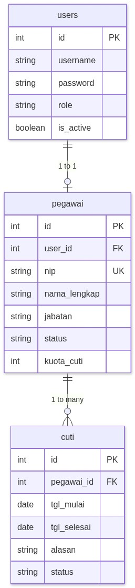
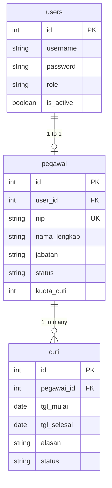

# SOFTWARE REQUIREMENTS SPECIFICATION (SRS) / FUNCTIONAL REQUIREMENTS DOCUMENT (FRD)
## Berdasarkan Standar ISO/IEC/IEEE 29148 & IEEE Std 830-1998

**Nama Proyek:** Sistem Informasi Kepegawaian PT INIX  
**Versi Dokumen:** 1.0  
**Tanggal:** 16 November 2026  
**Status:** Approved / Baseline for Testing  

---

## 1. Pendahuluan (Introduction)

### 1.1 Tujuan (Purpose)
Dokumen ini mendefinisikan spesifikasi kebutuhan fungsional (FRD) dan non-fungsional (SRS) untuk Aplikasi Kepegawaian internal PT INIX berbasis standar ISO/IEC/IEEE 29148 dan IEEE Std 830. Dokumen ini menjadi acuan utama tim pengembang, Quality Assurance (QA), dan stakeholder bisnis dalam verifikasi, validasi, perancangan test case, dan evaluasi risiko.

### 1.2 Cakupan Produk (Scope)
Sistem Informasi Kepegawaian PT INIX merupakan platform berbasis web untuk memfasilitasi operasional administrasi personalia inti, mencakup:
- Pengelolaan autentikasi akun dan Role-Based Access Control (RBAC).
- Pengelolaan master data pegawai (CRUD).
- Pengelolaan permohonan dan alur persetujuan cuti tahunan pegawai.

### 1.3 Definisi, Akronim, dan Singkatan
- **SRS:** Software Requirements Specification
- **FRD:** Functional Requirements Document
- **RBAC:** Role-Based Access Control
- **JWT:** JSON Web Token
- **NIP:** Nomor Induk Pegawai
- **CRUD:** Create, Read, Update, Delete
- **P95:** 95th Percentile Response Time
- **OWASP:** Open Web Application Security Project

### 1.4 Referensi
- IEEE Std 830-1998: *IEEE Recommended Practice for Software Requirements Specifications*.
- ISO/IEC/IEEE 29148:2018: *Systems and software engineering — Life cycle processes — Requirements engineering*.
- *STUDI_KASUS_INIX.md* & *LAB0_AI_PROMPT_ANALISIS_FRD_RISIKO.md*.

---

## 2. Deskripsi Keseluruhan (Overall Description)

### 2.1 Arsitektur & Lingkungan Operasional
Sistem berarsitektur 3-tier:
1. **Presentation Layer:** Client Browser React 19 (SPA / Vite).
2. **Application / Business Logic Layer:** REST API Node.js v26 LTS + Express.js v5.3 + Sequelize ORM v6.37.
3. **Data Layer:** MySQL Database 8.0.

### 2.2 Karakteristik Pengguna & Persona (RBAC)
| Role | Deskripsi Hak Akses |
|---|---|
| **Admin** | Akses penuh: Autentikasi, CRUD data pegawai, hapus data pegawai, kelola sistem. |
| **HR** | Akses administratif: Autentikasi, Read/Create/Update data pegawai, review data cuti. |
| **Manajer** | Akses pengawasan: Autentikasi, review dan Approval/Rejection cuti bawahan. |
| **Pegawai** | Akses mandiri: Autentikasi, melihat profil, cek kuota, pengajuan cuti tahunan. |

### 2.3 Batasan Desain & Implementasi
- Autentikasi berbasis Stateless Bearer JWT Token.
- Penyimpanan password menggunakan hashing aman (bcrypt).
- Batas kuota cuti tahunan pegawai adalah default 12 hari kalender kerja per tahun berjalan.
- Deployment menggunakan Docker Compose.

---

## 3. Spesifikasi Kebutuhan Sistem (Specific Requirements)

### 3.1 Kebutuhan Fungsional (Functional Requirements)

| Req ID | Modul | Deskripsi Kebutuhan | Prioritas | Sumber / Kriteria Verifikasi |
|---|---|---|---|---|
| **FR-001** | Autentikasi | Pengguna dapat login menggunakan username dan password valid untuk memperoleh JWT access token. | High | POST `/api/auth/login/`, token response format valid JWT. |
| **FR-002** | Autentikasi | Sistem menampilkan notifikasi/error HTTP 401 saat kredensial salah atau akun non-aktif (`is_active = false`). | High | Response 401 Unauthorized + validasi payload pesan error. |
| **FR-003** | Data Pegawai | Pengguna role Admin dan HR dapat melihat daftar, menambah, mengubah, dan menghapus (khusus Admin) data profil pegawai. | High | GET, POST, PUT, DELETE `/api/pegawai/`. |
| **FR-004** | Data Pegawai | Sistem melakukan validasi keunikan NIP (`nip` UNIQUE) dan mandatory check pada field Nama Lengkap dan Jabatan. | High | HTTP 400/409 jika NIP duplikat atau mandatory field kosong. |
| **FR-005** | Pengajuan Cuti | Pegawai dapat mengajukan cuti dengan input tanggal mulai, tanggal selesai, dan alasan; sistem memvalidasi sisa kuota tahunan (maksimal 12 hari). | High | POST `/api/cuti/`, validasi tanggal selesai ≥ mulai dan durasi ≤ kuota. |
| **FR-006** | Pengajuan Cuti | Manajer berwenang mengubah status pengajuan cuti pegawai menjadi `APPROVED` atau `REJECTED`. | High | PATCH `/api/cuti/{id}/status/`. |
| **FR-007** | Autentikasi | Sistem menerapkan Role-Based Access Control (RBAC) ketat pada tingkat routing halaman dan otorisasi API endpoint. | High | HTTP 403 Forbidden bila role tidak berwenang mengakses endpoint. |

### 3.2 User Stories & Acceptance Criteria

#### US-001: Autentikasi Akun Pengguna
- **Pernyataan:** *As a User, I want to login with my credentials, so that I can access the system.*
- **Kriteria Penerimaan:**
  1. Validasi field kosong pada username dan password menampilkan pesan kesalahan.
  2. Kredensial valid menghasilkan JWT token dan redirect ke halaman dashboard sesuai role.
  3. Kredensial tidak valid memunculkan notifikasi error yang informatif tanpa membocorkan eksistensi user.

#### US-002: Registrasi Pegawai Baru
- **Pernyataan:** *As an HR/Admin, I want to add a new employee, so that employee records are registered.*
- **Kriteria Penerimaan:**
  1. Field NIP wajib diisi dan harus unik di database.
  2. Field Nama Lengkap dan Jabatan wajib diisi.
  3. Data tersimpan di database MySQL (`pegawai`) dan otomatis muncul pada tabel daftar pegawai.

#### US-003: Pembaruan & Penghapusan Pegawai
- **Pernyataan:** *As an HR/Admin, I want to edit and delete employee records, so that data remains accurate.*
- **Kriteria Penerimaan:**
  1. Perubahan data pegawai terupdate secara langsung pada antarmuka pengguna (UI).
  2. Terdapat modal konfirmasi verifikasi sebelum proses penghapusan data pegawai dijalankan.
  3. Operasi delete hanya diizinkan untuk role Admin.

#### US-004: Pengajuan Cuti Tahunan
- **Pernyataan:** *As a Pegawai, I want to submit a leave request, so that I can take my planned leave.*
- **Kriteria Penerimaan:**
  1. Tanggal selesai pengajuan harus bernilai lebih besar atau sama dengan tanggal mulai (`tgl_selesai >= tgl_mulai`).
  2. Durasi pengajuan cuti tidak boleh melebihi sisa `kuota_cuti` tahunan berjalan (default 12 hari).
  3. Status awal pengajuan cuti yang baru dibuat bernilai default `PENDING`.

#### US-005: Persetujuan Pengajuan Cuti
- **Pernyataan:** *As a Manajer, I want to approve or reject leave requests, so that leave status is updated.*
- **Kriteria Penerimaan:**
  1. Manajer dapat memilih tindakan `Approve` atau `Reject` pada pengajuan cuti berstatus `PENDING`.
  2. Status cuti terupdate menjadi `APPROVED` atau `REJECTED` dan kuota cuti pegawai berkurang otomatis jika disetujui.

---

## 4. Kebutuhan Non-Fungsional (Non-Functional Requirements)

| Req ID | Kategori | Deskripsi Kebutuhan | Standar / Metrik Keberhasilan |
|---|---|---|---|
| **NFR-001** | Performance | Latensi respon endpoint autentikasi dan data pegawai harus cepat di bawah beban normal. | Response time ≤ 500ms pada persentil P95 dengan beban 50 concurrent users (pengujian via k6). |
| **NFR-002** | Security | Form input dan REST API harus kebal terhadap ancaman injeksi dan scripting berbahaya. | Bebas dari celah OWASP Top 10 (khususnya SQL Injection pada Sequelize dan XSS pada input UI). |
| **NFR-003** | Compatibility | Tampilan antarmuka (UI React) konsisten dan berfungsi pada berbagai peramban modern. | Lolos uji cross-browser (Google Chrome, Microsoft Edge, Mozilla Firefox versi stabil terbaru). |
| **NFR-004** | Security | Data kredensial pengguna dan sesi token harus terenkripsi aman. | Password di-hash menggunakan algoritma aman (bcrypt/PBKDF2); token JWT memiliki masa kedaluwarsa (expiry). |

---

## 5. Model Data & Skema Database

### 5.1 Diagram Relasi Entitas (ERD)

---

## 6. Antarmuka Eksternal & Endpoint API

| Method | Endpoint | Deskripsi | Hak Akses (RBAC) |
|---|---|---|---|
| `POST` | `/api/auth/login/` | Autentikasi user & generate JWT access token | Public |
| `POST` | `/api/auth/refresh/` | Refresh JWT access token | Public |
| `GET` | `/api/pegawai/` | Menampilkan seluruh daftar data pegawai | Bearer JWT (Semua Role) |
| `POST` | `/api/pegawai/` | Menambahkan data pegawai baru | Bearer JWT (HR, Admin) |
| `GET` | `/api/pegawai/{id}/` | Menampilkan detail data pegawai tertentu | Bearer JWT (Semua Role) |
| `PUT` | `/api/pegawai/{id}/` | Memperbarui data pegawai | Bearer JWT (HR, Admin) |
| `DELETE` | `/api/pegawai/{id}/` | Menghapus data pegawai | Bearer JWT (Admin) |
| `GET` | `/api/cuti/` | Menampilkan daftar seluruh pengajuan cuti | Bearer JWT (Semua Role) |
| `GET` | `/api/cuti/kuota` | Menampilkan sisa kuota cuti tahunan pegawai | Bearer JWT (Pegawai) |
| `POST` | `/api/cuti/` | Mengajukan permohonan cuti baru | Bearer JWT (Pegawai) |
| `PATCH` | `/api/cuti/{id}/status/`| Memperbarui status persetujuan cuti | Bearer JWT (Manajer) |

---

## 7. Matriks Keterlacakan Kebutuhan (Requirements Traceability Matrix)

| Req ID | User Story | API Endpoint | Modul |
|---|---|---|---|
| FR-001 | US-001 | POST `/api/auth/login/` | Autentikasi |
| FR-002 | US-001 | POST `/api/auth/login/` | Autentikasi |
| FR-003 | US-002, US-003 | GET/POST/PUT/DELETE `/api/pegawai/` | Data Pegawai |
| FR-004 | US-002 | POST/PUT `/api/pegawai/` | Data Pegawai |
| FR-005 | US-004 | POST `/api/cuti/`, GET `/api/cuti/kuota` | Pengajuan Cuti |
| FR-006 | US-005 | PATCH `/api/cuti/{id}/status/` | Pengajuan Cuti |
| FR-007 | All | Seluruh Endpoint Terproteksi | Autentikasi |
| NFR-001 | US-001, US-002 | `/api/auth/login/`, `/api/pegawai/` | Non-Fungsional |
| NFR-002 | All | Form UI & API Payload | Non-Fungsional |
| NFR-003 | All | Frontend SPA | Non-Fungsional |
| NFR-004 | US-001 | Database & Auth Service | Non-Fungsional |
