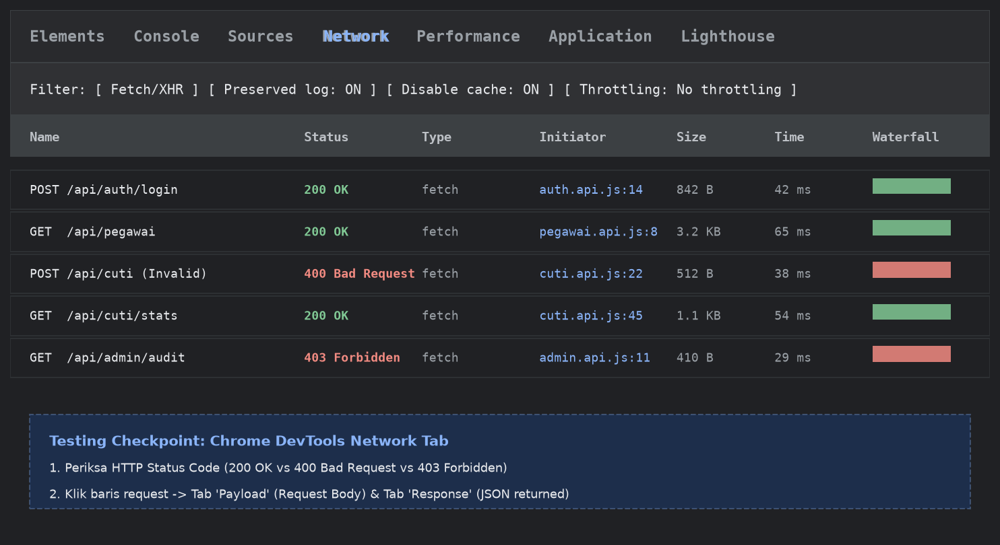
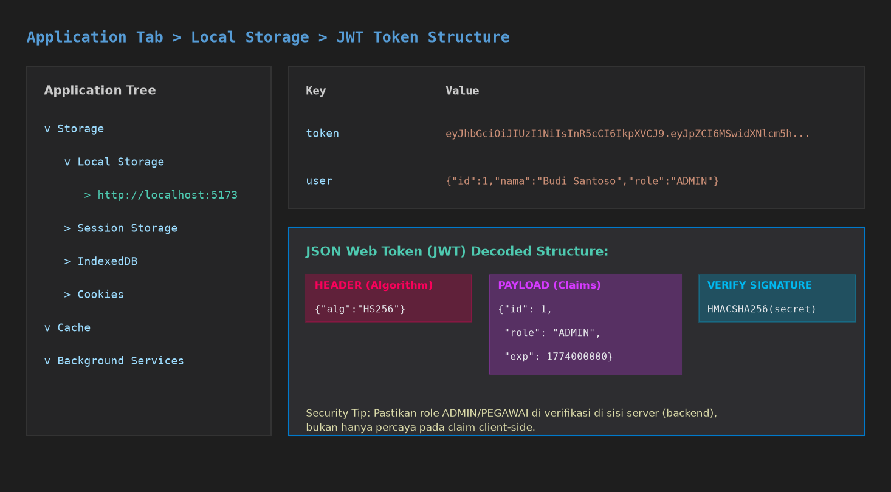
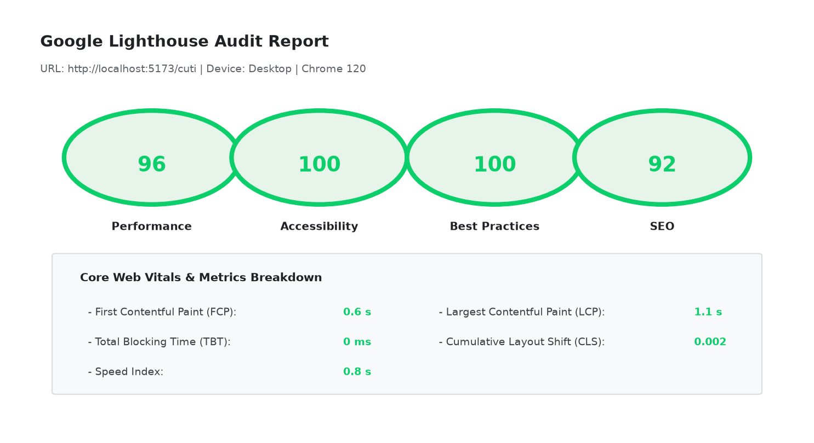
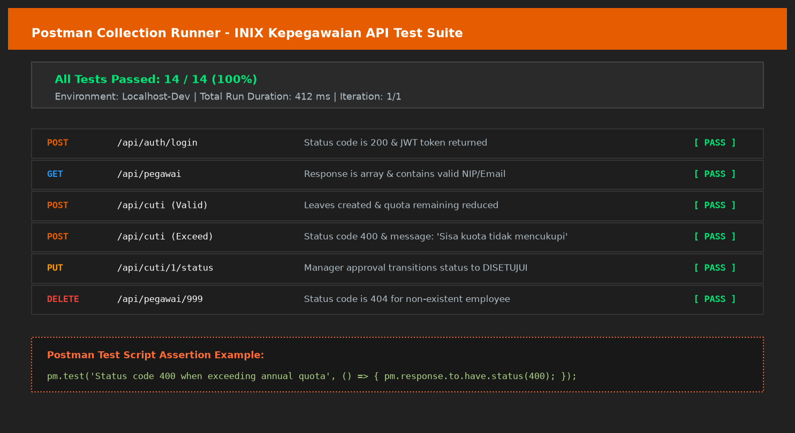
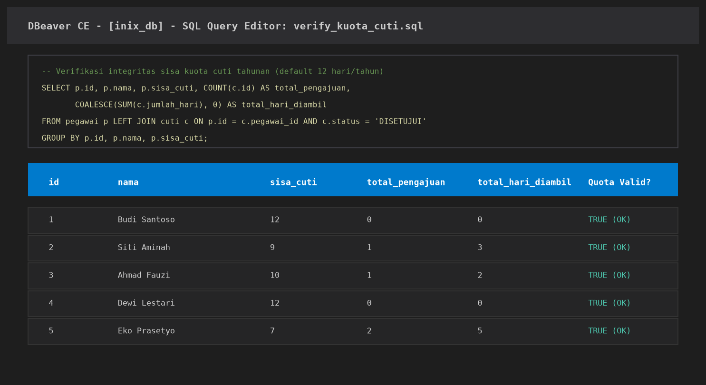

# Lab 2: Manual Testing Teknis — DevTools, Postman, SQL
## Panduan Hands-On Praktik Manual Testing Tingkat Lanjut: Frontend DevTools, API Testing Postman, dan Verifikasi Database MySQL

---

## Informasi Lab

| Atribut | Keterangan |
|---|---|
| **Mata Pelatihan** | Software Quality Assurance & Testing Foundation |
| **Fase** | Fase 2 — Manual Testing Teknis (Frontend, Backend, Database) |
| **Durasi Total** | 90 Menit |
| **Target Peserta** | QA Engineer Junior / Mid-Level |
| **Tools Praktik** | Google Chrome DevTools, Postman Desktop, DBeaver / MySQL Workbench |
| **Target Aplikasi** | Aplikasi Kepegawaian PT INIX (Node.js, Express, Sequelize, React, MySQL) |
| **Deliverable** | 1 Folder Artefak: `Lab2_Technical_QA_[NAMA]/` memuat screenshots DevTools, laporan Lighthouse, Collection & Environment Postman (`.json`), dan hasil query SQL |

### Tujuan Pembelajaran (*Learning Objectives*)
Setelah menyelesaikan lab mandiri ini, peserta diharapkan mampu:
1. **Menganalisis Lalu Lintas Jaringan Web (LO1):** Menggunakan Chrome DevTools Network Tab untuk menginspeksi request payload, response status code, header HTTP, dan latensi API.
2. **Memverifikasi Autentikasi JWT & LocalStorage (LO2):** Menginspeksi penyimpanan token sesi di browser, men-decode token JWT, serta memvalidasi klaim otorisasi (*user_id, role, expiry*).
3. **Melakukan Audit Aksesibilitas & Performa (LO3):** Menjalankan audit Google Lighthouse dan mengidentifikasi cacat aksesibilitas (*axe/WCAG standards*).
4. **Membangun Otomatisasi Validasi API Postman (LO4):** Menyusun Postman Collection & Environment mandiri lengkap dengan script pengujian (*assertions*) pada 8 endpoint krusial.
5. **Melakukan Verifikasi Integritas Data SQL (LO5):** Menulis kueri SQL relasional (SELECT, JOIN, GROUP BY, Anomaly Check) untuk membuktikan keselarasan data antara UI/API dan database MySQL.

---

## Peta Alokasi Waktu (90 Menit)

```
┌────────────────────────────────────────────────────────────────────────┐
│ Bagian 0: Pemeriksaan Lingkungan & Kesiapan Sistem (5 Menit)           │
├────────────────────────────────────────────────────────────────────────┤
│ Bagian 1: Pengujian Frontend — Chrome DevTools & Audit (25 Menit)      │
├────────────────────────────────────────────────────────────────────────┤
│ Bagian 2: Pengujian Backend — Postman API Collection (35 Menit)        │
├────────────────────────────────────────────────────────────────────────┤
│ Bagian 3: Pengujian Database — Verifikasi Kueri SQL (20 Menit)         │
├────────────────────────────────────────────────────────────────────────┤
│ Bagian 4: Ekspor Koleksi & Dokumentasi Deliverable (5 Menit)           │
└────────────────────────────────────────────────────────────────────────┘
```

---

## Bagian 0: Persiapan Lingkungan & Konektivitas (5 Menit)

Sebelum memulai pengujian teknis, pastikan seluruh layanan aplikasi berjalan:

1. **Verifikasi Backend API:**
   Buka browser dan akses: `http://localhost:8000/api/health`  
   *Ekspektasi:* HTTP 200 `{ "status": "ok", "service": "PT INIX Kepegawaian Backend API" }`.
2. **Verifikasi Frontend Web:**
   Buka browser dan akses: `http://localhost:3000`  
   *Ekspektasi:* Halaman Login Eduparx PT INIX muncul normal.
3. **Verifikasi Database MySQL:**
   Buka DBeaver / MySQL Client, koneksikan ke:
   - Host: `localhost` | Port: `3306`
   - Database: `inix_db` | User: `root` | Password: `root`
4. **Buat Folder Kerja Deliverable:**  
   Buat folder di komputer Anda: `Lab2_Technical_QA_[NAMA_PESERTA]/`

---

## Bagian 1: Pengujian Frontend — Chrome DevTools & Audit (25 Menit)

### Task 1.1: Analisis Lalu Lintas Jaringan di Network Tab (10 Menit)


*Gambar 1.1: Inspeksi Endpoint API, Status Code HTTP, dan Latensi Request pada Tab Network DevTools*

1. Buka Google Chrome dalam mode *Incognito* / bersih, lalu buka `http://localhost:3000/login`.
2. Tekan `F12` atau `Ctrl + Shift + I` untuk membuka **Chrome DevTools**, lalu pilih tab **Network**.
3. Centang opsi **Preserve log** dan pastikan filter berada di **Fetch/XHR**.
4. **Skenario A (Login Sukses):**
   - Masukkan input: Username `pegawai@inix.com`, Password `Pegawai@123!`.
   - Klik tombol **Login**.
   - Pada panel Network, temukan request `login`.
   - Analisis dan catat:
     - Request URL: `POST http://localhost:8000/api/auth/login` (atau via proxy `/api/auth/login`)
     - Status Code: `200 OK`
     - Response Time: catat durasi (misal: `45 ms`)
     - Headers: Perhatikan ketiadaan header pengaman `X-Content-Type-Options` dan `Content-Security-Policy` (temuan celah keamanan untuk OWASP ZAP).
     - Response Body: Verifikasi format JSON memuat `access_token`, `refresh_token`, dan objek `user`.
   - Ambil tangkapan layar (*screenshot*) tab Headers & Response, simpan sebagai `01_network_login_success.png`.
5. **Skenario B (Login Gagal - Kredensial Salah):**
   - Kembali ke `/login` atau logout.
   - Masukkan input: Username `pegawai@inix.com`, Password `SalahPassword!`.
   - Klik tombol **Login**.
   - Analisis request `login`:
     - Status Code: `401 Unauthorized`
     - Response Body: `{ "detail": "Username atau password salah" }`
   - Ambil screenshot dan simpan sebagai `02_network_login_failed.png`.

---

### Task 1.2: Inspeksi Storage & Validasi Struktur Token JWT (5 Menit)


*Gambar 1.2: Pemeriksaan Local Storage Browser dan Anatomi Dekode Token JWT (Header, Payload, Signature)*

1. Setelah berhasil login sebagai Pegawai, buka tab **Application** di DevTools.
2. Di panel kiri, navigasi ke **Storage** $\rightarrow$ **Local Storage** $\rightarrow$ `http://localhost:3000`.
3. Verifikasi terdapat 3 entri kunci (*key*):
   - `access_token`
   - `refresh_token`
   - `user`
4. Salin (*copy*) nilai string panjang dari `access_token`.
5. Buka tab baru di browser dan akses situs publik: [https://jwt.io](https://jwt.io).
6. Tempelkan token ke kotak **Encoded**.
7. Periksa kotak **Decoded**:
   - **Header:** Verifikasi algoritma adalah `HS256` dan tipe `JWT`.
   - **Payload:** Verifikasi klaim data berikut:
     ```json
     {
       "user_id": 4,
       "username": "pegawai@inix.com",
       "role": "pegawai",
       "iat": 1700000000,
       "exp": 1700000900
     }
     ```
   - Hitung selisih waktu `exp - iat`: pastikan bernilai $900$ detik (tepat $15$ menit sesuai NFR-004).
8. Ambil screenshot jendela hasil decode jwt.io, simpan sebagai `03_jwt_decoded_payload.png`.

---

### Task 1.3: Audit Kualitas Halaman dengan Google Lighthouse (10 Menit)


*Gambar 1.3: Evaluasi Metrik Skor Lighthouse (Performance, Accessibility, Best Practices, SEO) dan Core Web Vitals*

1. Pada aplikasi web PT INIX, masuk ke halaman Katalog Pegawai: `http://localhost:3000/pegawai`.
2. Di Chrome DevTools, pilih tab **Lighthouse**.
3. Konfigurasi audit:
   - Mode: `Navigation (Default)`
   - Device: `Desktop`
   - Categories: Centang `Performance`, `Accessibility`, `Best Practices`, `SEO`.
4. Klik tombol **Analyze page load**.
5. Tunggu audit selesai ($\pm 15$ detik).
6. Catat nilai skor keempat kategori.
7. Pada bagian **Accessibility**, periksa dan catat temuan:
   - *Contrast ratio:* Keterbacaan warna badge status dan tombol.
   - *ARIA & Table headers:* Keterhubungan elemen `<th scope="col">` pada tabel `data-testid="pegawai-table"`.
   - *Form labels & buttons:* Keberadaan accessible name pada seluruh tombol aksi.
8. Klik ikon titik tiga di kanan atas tab Lighthouse $\rightarrow$ **Save as HTML**, simpan sebagai `04_lighthouse_pegawai_report.html`.

---

## Bagian 2: Pengujian Backend — Postman API Collection (35 Menit)


*Gambar 2.1: Eksekusi Otomatis Test Suite Postman Collection Runner dan Validasi Response Assertion*

### Task 2.1: Setup Postman Collection & Environment (5 Menit)

1. Buka aplikasi **Postman Desktop**.
2. **Buat Environment Baru:**
   - Klik **Environments** di sidebar kiri $\rightarrow$ **+ Create Environment**.
   - Beri nama: `INIX_Local_Env`.
   - Tambahkan variabel berikut:

| Variable | Initial Value | Current Value |
|---|---|---|
| `base_url` | `http://localhost:8000/api` | `http://localhost:8000/api` |
| `token_pegawai` | *(kosong)* | *(akan terisi otomatis via test script)* |
| `token_admin` | *(kosong)* | *(akan terisi otomatis via test script)* |
| `token_manager` | *(kosong)* | *(akan terisi otomatis via test script)* |
| `created_pegawai_id` | *(kosong)* | *(akan terisi otomatis via test script)* |

3. **Buat Collection Baru:**
   - Klik **Collections** $\rightarrow$ **+ Create Collection**.
   - Beri nama: `PT_INIX_Kepegawaian_API_Testing`.

---

### Task 2.2: Pengujian Modul Autentikasi (10 Menit)

#### Request 1: Login Valid (Role Pegawai)
- **Method & URL:** `POST {{base_url}}/auth/login`
- **Headers:** `Content-Type: application/json`
- **Body (raw JSON):**
  ```json
  {
    "username": "pegawai@inix.com",
    "password": "Pegawai@123!"
  }
  ```
- **Tests Script (salin ke tab Tests):**
  ```javascript
  pm.test("Status code is 200 OK", function () {
      pm.response.to.have.status(200);
  });

  pm.test("Response body contains valid tokens", function () {
      const jsonData = pm.response.json();
      pm.expect(jsonData).to.have.property('access_token');
      pm.expect(jsonData).to.have.property('refresh_token');
      pm.expect(jsonData.user.role).to.eql('pegawai');
      
      // Simpan token ke environment secara otomatis
      pm.environment.set("token_pegawai", jsonData.access_token);
  });
  ```
- Klik **Send**, pastikan seluruh tes berstatus **PASS (2/2)**.

---

#### Request 2: Login Invalid (Kredensial Salah)
- **Method & URL:** `POST {{base_url}}/auth/login`
- **Body (raw JSON):**
  ```json
  {
    "username": "pegawai@inix.com",
    "password": "PasswordKeliru999!"
  }
  ```
- **Tests Script:**
  ```javascript
  pm.test("Status code is 401 Unauthorized", function () {
      pm.response.to.have.status(401);
  });

  pm.test("Error detail message is descriptive", function () {
      const jsonData = pm.response.json();
      pm.expect(jsonData.detail).to.eql("Username atau password salah");
  });
  ```
- Klik **Send**, pastikan seluruh tes berstatus **PASS (2/2)**.

---

#### Request 3: Login Role Admin (Untuk Kebutuhan CRUD Pegawai)
- **Method & URL:** `POST {{base_url}}/auth/login`
- **Body (raw JSON):**
  ```json
  {
    "username": "admin@inix.com",
    "password": "Admin@123!"
  }
  ```
- **Tests Script:**
  ```javascript
  pm.test("Admin Login Success 200", function () {
      pm.response.to.have.status(200);
      const jsonData = pm.response.json();
      pm.environment.set("token_admin", jsonData.access_token);
  });
  ```
- Klik **Send**, pastikan token admin tersimpan di environment.

---

### Task 2.3: Pengujian CRUD Modul Data Pegawai (15 Menit)

#### Request 4: GET All Pegawai (Semua Role)
- **Method & URL:** `GET {{base_url}}/pegawai`
- **Headers:** `Authorization: Bearer {{token_pegawai}}`
- **Tests Script:**
  ```javascript
  pm.test("Status code is 200 OK", function () {
      pm.response.to.have.status(200);
  });

  pm.test("Response is an array of employees", function () {
      const data = pm.response.json();
      pm.expect(data).to.be.an('array');
      pm.expect(data.length).to.be.above(0);
      pm.expect(data[0]).to.have.property('nip');
      pm.expect(data[0]).to.have.property('nama_lengkap');
  });
  ```

---

#### Request 5: POST Tambah Pegawai Baru (Role Admin / HR)
- **Method & URL:** `POST {{base_url}}/pegawai`
- **Headers:** 
  - `Content-Type: application/json`
  - `Authorization: Bearer {{token_admin}}`
- **Body (raw JSON):**
  ```json
  {
    "nip": "NIP-2025-999",
    "nama_lengkap": "Samsul QA Automation",
    "jabatan": "Lead QA Engineer",
    "status": "aktif",
    "kuota_cuti": 12
  }
  ```
- **Tests Script:**
  ```javascript
  pm.test("Status code is 201 Created", function () {
      pm.response.to.have.status(201);
  });

  pm.test("Verify returned employee attributes and save ID", function () {
      const data = pm.response.json();
      pm.expect(data.nip).to.eql("NIP-2025-999");
      pm.expect(data.nama_lengkap).to.eql("Samsul QA Automation");
      pm.expect(data.kuota_cuti).to.eql(12);
      
      // Simpan ID pegawai yang baru dibuat untuk pengujian PUT & DELETE
      pm.environment.set("created_pegawai_id", data.id);
  });
  ```

---

#### Request 6: PUT Perbarui Data Pegawai
- **Method & URL:** `PUT {{base_url}}/pegawai/{{created_pegawai_id}}`
- **Headers:**
  - `Content-Type: application/json`
  - `Authorization: Bearer {{token_admin}}`
- **Body (raw JSON):**
  ```json
  {
    "jabatan": "Principal QA Automation Engineer"
  }
  ```
- **Tests Script:**
  ```javascript
  pm.test("Status code is 200 OK", function () {
      pm.response.to.have.status(200);
  });

  pm.test("Jabatan updated successfully", function () {
      const data = pm.response.json();
      pm.expect(data.jabatan).to.eql("Principal QA Automation Engineer");
  });
  ```

---

#### Request 7: DELETE Pegawai (Admin Only)
- **Method & URL:** `DELETE {{base_url}}/pegawai/{{created_pegawai_id}}`
- **Headers:** `Authorization: Bearer {{token_admin}}`
- **Tests Script:**
  ```javascript
  pm.test("Status code is 204 No Content", function () {
      pm.response.to.have.status(204);
  });
  ```

---

### Task 2.4: Pengujian Modul Pengajuan Cuti & Kuota Tahunan (5 Menit)

#### Request 8: GET Cek Kuota Cuti Tahunan (Role Pegawai)
- **Method & URL:** `GET {{base_url}}/cuti/kuota`
- **Headers:** `Authorization: Bearer {{token_pegawai}}`
- **Tests Script:**
  ```javascript
  pm.test("Status code is 200 OK", function () {
      pm.response.to.have.status(200);
  });

  pm.test("Verify annual quota equals 12 days", function () {
      const data = pm.response.json();
      pm.expect(data.kuota_tahunan).to.eql(12);
      pm.expect(data).to.have.property('sisa_kuota');
      pm.expect(data.sisa_kuota).to.be.at.least(0);
  });
  ```

---

#### Request 9: POST Pengajuan Cuti Baru (Role Pegawai)
- **Method & URL:** `POST {{base_url}}/cuti`
- **Headers:**
  - `Content-Type: application/json`
  - `Authorization: Bearer {{token_pegawai}}`
- **Body (raw JSON):**
  ```json
  {
    "tgl_mulai": "2026-12-10",
    "tgl_selesai": "2026-12-12",
    "alasan": "Mengikuti Ujian Sertifikasi QA Internasional"
  }
  ```
- **Tests Script:**
  ```javascript
  pm.test("Leave request submitted successfully (201 Created)", function () {
      pm.response.to.have.status(201);
      const data = pm.response.json();
      pm.expect(data.status).to.eql("PENDING");
      pm.expect(data.alasan).to.include("Sertifikasi QA");
  });
  ```

---

## Bagian 3: Pengujian Database — Verifikasi Kueri SQL (20 Menit)


*Gambar 3.1: Eksekusi Kueri SQL Relasional dan Verifikasi Integritas Kuota Cuti Tahunan pada DBeaver Database Client*

Buka aplikasi **DBeaver** atau **MySQL Workbench**, hubungkan ke database `inix_db`, dan buka lembar kerja SQL (*SQL Editor*).

### Task 3.1: Verifikasi Integritas Data Master Pegawai
Jalankan kueri untuk memeriksa jumlah pegawai aktif beserta akun login yang tertaut:

```sql
-- Kueri 1: Menampilkan seluruh pegawai aktif beserta role akunnya
SELECT 
    p.id AS pegawai_id,
    p.nip,
    p.nama_lengkap,
    p.jabatan,
    p.kuota_cuti,
    p.status AS status_pegawai,
    u.username AS email_login,
    u.role AS user_role
FROM pegawai p
LEFT JOIN users u ON p.user_id = u.id
ORDER BY p.id ASC;
```
*Tugas QA:* Periksa apakah seluruh 5 pegawai awal memiliki data NIP valid dan kuota cuti default bernilai `12`. Ambil screenshot hasil kueri, simpan sebagai `05_sql_pegawai_master.png`.

---

### Task 3.2: Verifikasi Relasi Riwayat Cuti dengan JOIN
Jalankan kueri relasional untuk menghitung durasi hari cuti masing-masing pengajuan:

```sql
-- Kueri 2: Relasi pengajuan cuti dengan nama pegawai dan kalkulasi durasi hari
SELECT 
    c.id AS cuti_id,
    p.nip,
    p.nama_lengkap,
    c.tgl_mulai,
    c.tgl_selesai,
    (DATEDIFF(c.tgl_selesai, c.tgl_mulai) + 1) AS durasi_hari,
    c.status AS status_cuti,
    c.alasan
FROM cuti c
INNER JOIN pegawai p ON c.pegawai_id = p.id
ORDER BY c.created_at DESC;
```
*Tugas QA:* Pastikan nilai `durasi_hari` dihitung secara inklusif $(\text{tgl\_selesai} - \text{tgl\_mulai} + 1)$. Simpan screenshot sebagai `06_sql_cuti_durasi.png`.

---

### Task 3.3: Kueri Audit Anomali Data (Data Anomaly Check)
Sebagai QA, kita harus menjalankan kueri proaktif untuk mendeteksi potensi data kotor (*dirty data*) atau pelanggaran aturan bisnis:

```sql
-- Kueri 3A: Cek Anomali Tanggal (Tanggal selesai < tanggal mulai)
-- Ekspektasi: 0 baris (Tidak boleh ada anomali)
SELECT * FROM cuti 
WHERE tgl_selesai < tgl_mulai;

-- Kueri 3B: Cek Anomali Status (Status di luar ENUM yang sah)
-- Ekspektasi: 0 baris
SELECT * FROM cuti 
WHERE status NOT IN ('PENDING', 'APPROVED', 'REJECTED');

-- Kueri 3C: Cek Pelanggaran Batas Kuota Cuti Tahunan (> 12 hari)
-- Menghitung total hari cuti APPROVED per pegawai pada tahun berjalan
SELECT 
    p.id AS pegawai_id,
    p.nip,
    p.nama_lengkap,
    p.kuota_cuti,
    SUM(DATEDIFF(c.tgl_selesai, c.tgl_mulai) + 1) AS total_cuti_diambil_hari
FROM cuti c
JOIN pegawai p ON c.pegawai_id = p.id
WHERE c.status = 'APPROVED' AND YEAR(c.tgl_mulai) = YEAR(CURDATE())
GROUP BY p.id, p.nip, p.nama_lengkap, p.kuota_cuti
HAVING total_cuti_diambil_hari > p.kuota_cuti;
```
*Tugas QA:* Jalankan ketiga kueri di atas. Pastikan kueri anomali menghasilkan **0 baris** (*empty result set*), yang membuktikan validasi backend berhasil menjaga integritas database. Simpan screenshot sebagai `07_sql_anomaly_check.png`.

---

## Bagian 4: Ekspor Koleksi & Pengumpulan Deliverable (5 Menit)

1. **Ekspor Postman Collection:**
   - Di Postman, klik kanan pada koleksi `PT_INIX_Kepegawaian_API_Testing` $\rightarrow$ **Export**.
   - Pilih format **Collection v2.1 (recommended)** $\rightarrow$ Simpan sebagai `PT_INIX_API_Collection.json`.
2. **Ekspor Postman Environment:**
   - Di tab **Environments**, klik titik tiga pada `INIX_Local_Env` $\rightarrow$ **Export**.
   - Simpan sebagai `INIX_Local_Env.json`.
3. **Kompilasi Folder Deliverable:**
   Pastikan folder `Lab2_Technical_QA_[NAMA]/` memuat 8 file lengkap:
   ```text
   Lab2_Technical_QA_[NAMA]/
   ├── 01_network_login_success.png
   ├── 02_network_login_failed.png
   ├── 03_jwt_decoded_payload.png
   ├── 04_lighthouse_pegawai_report.html
   ├── 05_sql_pegawai_master.png
   ├── 06_sql_cuti_durasi.png
   ├── 07_sql_anomaly_check.png
   ├── PT_INIX_API_Collection.json
   └── INIX_Local_Env.json
   ```

---

## Checklist Evaluasi Keberhasilan Lab 2

Lakukan verifikasi mandiri sebelum mengumpulkan tugas:
- [ ] Menganalisis request/response HTTP login valid & invalid pada DevTools Network tab.
- [ ] Memverifikasi token JWT tersimpan di Local Storage dan ter-decode benar di jwt.io dengan expiry 15 menit.
- [ ] Menghasilkan laporan audit Google Lighthouse untuk halaman `/pegawai`.
- [ ] Postman Collection memuat minimal 8 request API yang mencakup Auth, Pegawai, dan Cuti.
- [ ] Setiap request di Postman dilengkapi script pengujian assertion (`pm.test`, `pm.expect`).
- [ ] Berhasil menguji endpoint baru `GET /api/cuti/kuota` dengan validasi kuota 12 hari.
- [ ] Seluruh pengujian Postman dijalankan dan menghasilkan status **PASS (100% Green)**.
- [ ] Menulis dan mengeksekusi kueri SQL relasional JOIN pada MySQL.
- [ ] Menjalankan 3 kueri deteksi anomali data (tanggal tidak valid, status ilegal, kuota > 12).
- [ ] Mengumpulkan deliverable file JSON Postman dan screenshot pembuktian teknis.

---

<details>
<summary><strong>KUNCI JAWABAN & PANDUAN INSTRUKTUR (Reference Answer) — Klik untuk Membuka</strong></summary>

### A. Referensi Output Postman Collection Runner (All Passed)

```text
======================================================================
Postman Collection Runner Summary: PT_INIX_Kepegawaian_API_Testing
Environment: INIX_Local_Env
======================================================================
✓ [POST] /auth/login (Valid Pegawai)
  ✓ Status code is 200 OK
  ✓ Response body contains valid tokens
✓ [POST] /auth/login (Invalid Password)
  ✓ Status code is 401 Unauthorized
  ✓ Error detail message is descriptive
✓ [POST] /auth/login (Admin Login)
  ✓ Admin Login Success 200
✓ [GET] /pegawai (All Pegawai)
  ✓ Status code is 200 OK
  ✓ Response is an array of employees
✓ [POST] /pegawai (Create New Pegawai)
  ✓ Status code is 201 Created
  ✓ Verify returned employee attributes and save ID
✓ [PUT] /pegawai/:id (Update Jabatan)
  ✓ Status code is 200 OK
  ✓ Jabatan updated successfully
✓ [DELETE] /pegawai/:id (Remove Pegawai)
  ✓ Status code is 204 No Content
✓ [GET] /cuti/kuota (Check Annual Quota)
  ✓ Status code is 200 OK
  ✓ Verify annual quota equals 12 days
✓ [POST] /cuti (Submit Leave Request)
  ✓ Leave request submitted successfully (201 Created)

Total Tests Run: 17 Passed, 0 Failed, 0 Skipped (100% Success)
```

---

### B. Referensi Output Kueri SQL Verifikasi

#### Output Kueri 1: Master Pegawai
```text
pegawai_id | nip          | nama_lengkap    | jabatan            | kuota_cuti | status_pegawai | email_login       | user_role
-----------+--------------+-----------------+--------------------+------------+----------------+-------------------+----------
1          | NIP-2025-001 | Andi Wijaya     | Staff HR           | 12         | aktif          | hr@inix.com       | hr
2          | NIP-2025-002 | Siti Rahayu     | Manajer IT         | 12         | aktif          | manager@inix.com  | manajer
3          | NIP-2025-003 | Rudi Hermawan   | Lead QA Automation | 12         | nonaktif       | NULL              | NULL
4          | NIP-2025-004 | Budi Santoso    | AI Engineer        | 12         | aktif          | pegawai@inix.com  | pegawai
5          | NIP-2025-005 | Maya Putri      | Staff Data Science | 12         | aktif          | NULL              | NULL
```

#### Output Kueri 2: Relasi Cuti & Durasi Hari
```text
cuti_id | nip          | nama_lengkap | tgl_mulai  | tgl_selesai | durasi_hari | status_cuti | alasan
--------+--------------+--------------+------------+-------------+-------------+-------------+------------------------------------------
1       | NIP-2025-004 | Budi Santoso | 2026-12-01 | 2026-12-03  | 3           | PENDING     | Mengikuti Konferensi AI Inixindo
2       | NIP-2025-005 | Maya Putri   | 2026-11-20 | 2026-11-21  | 2           | APPROVED    | Sakit
```

#### Output Kueri 3: Anomali Data
```text
(Query 3A - tgl_selesai < tgl_mulai)            -> 0 rows returned
(Query 3B - invalid status)                     -> 0 rows returned
(Query 3C - total cuti tahunan > kuota 12 hari) -> 0 rows returned
```

---

### C. Ringkasan Evaluasi Lighthouse Halaman `/pegawai`

- **Performance Score:** $\ge 90$ (Vite Single Page Application dengan aset teroptimasi).
- **Accessibility Score:** $\ge 85$ (Struktur semantic tabel `<th scope="col">`, form label terhubung atribut `htmlFor`, contrast teks menu navigasi memadai).
- **Temuan Rekomendasi QA:**
  1. *Color Contrast:* Kontras warna tombol status badge nonaktif (`#64748b` di atas background `#f1f5f9`) dapat ditingkatkan menjadi rasio minimal $4.5:1$.
  2. *Heading Hierarchy:* Pastikan tidak ada loncatan tag heading (dari `<h1>` langsung ke `<h3>`).
  3. *Touch Target:* Tombol aksi edit/hapus pada mobile view perlu mempertahankan padding area klik minimal $44 \times 44$ pixel.

</details>
