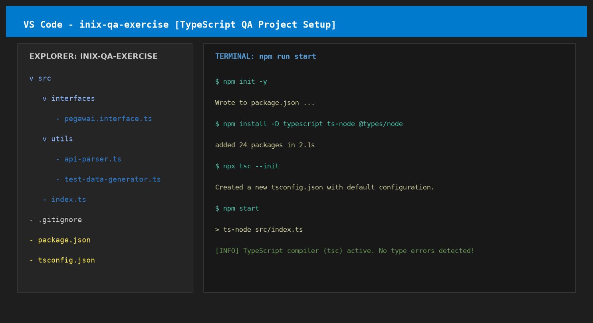
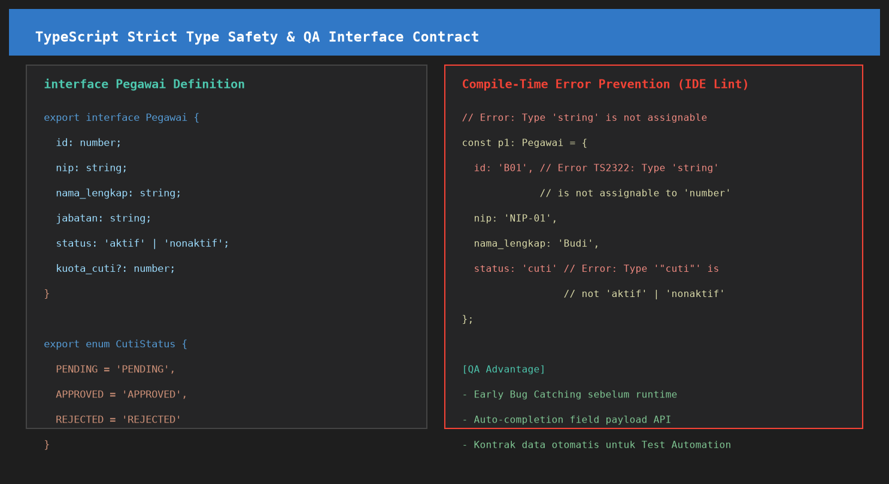
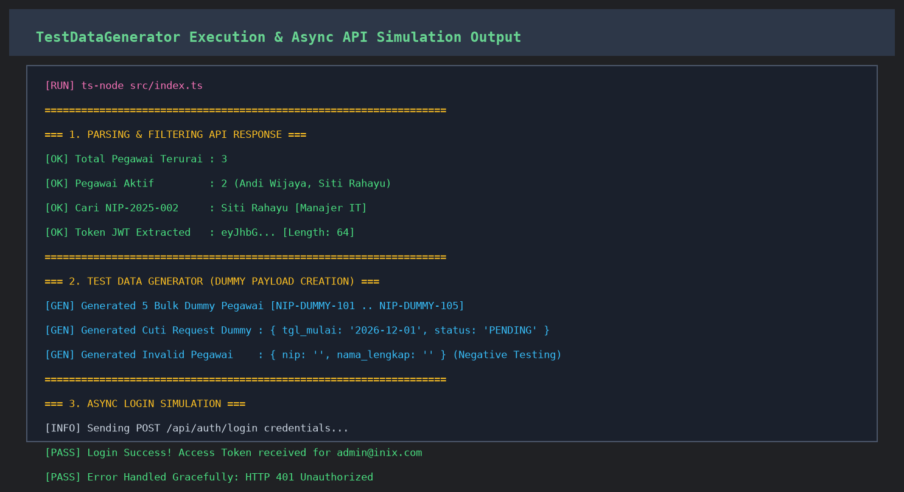
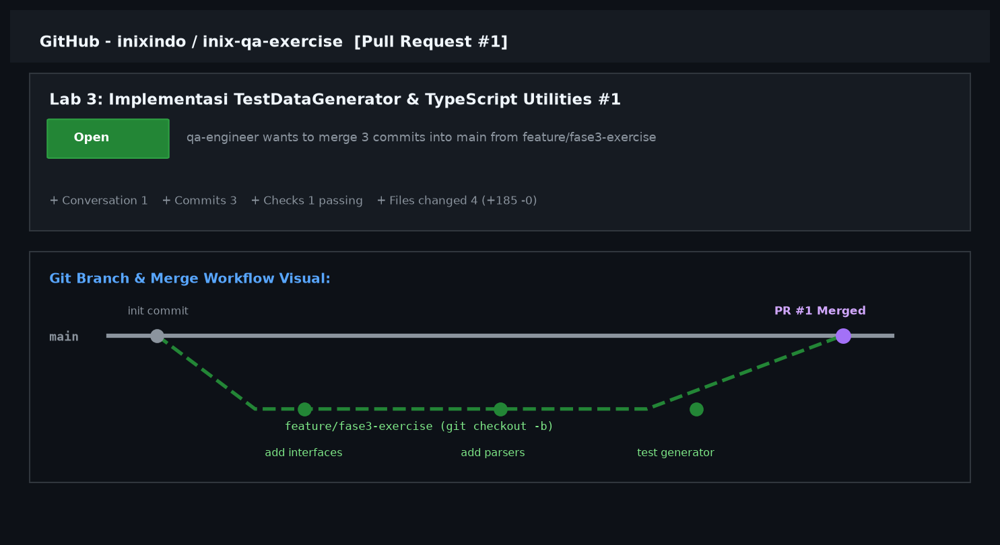

# Lab 3: Pemrograman TypeScript untuk QA — Setup, Coding, Git
## Panduan Hands-On Pemrograman Dasar TypeScript, Data Parsing API, Test Data Generator, dan Git Workflow untuk QA Engineer

---

## Informasi Lab

| Atribut | Keterangan |
|---|---|
| **Mata Pelatihan** | Software Quality Assurance & Test Automation Foundation |
| **Fase** | Fase 3 — Pemrograman untuk QA (TypeScript & Git) |
| **Durasi Total** | 75 Menit |
| **Target Peserta** | QA Engineer Junior / Mid-Level (Pemula dalam pemrograman) |
| **Tools Praktik** | Node.js (v20+), TypeScript, ts-node, VS Code, Git, GitHub |
| **Target Aplikasi** | Parser & Test Data Utility untuk API Kepegawaian PT INIX |
| **Deliverable** | Repository GitHub publik `inix-qa-exercise` + 1 Pull Request (PR) aktif |

### Tujuan Pembelajaran (*Learning Objectives*)
Setelah menyelesaikan lab ini, peserta diharapkan mampu:
1. **Inisialisasi Project TypeScript (LO1):** Menyiapkan lingkungan runtime TypeScript menggunakan Node.js, `npm`, dan konfigurasi `tsconfig.json`.
2. **Mendefinisikan Kontrak Data (LO2):** Menyusun `interface` dan `enum` statis untuk validasi skema data response API Kepegawaian dan Autentikasi.
3. **Parsing & Filtering Data API (LO3):** Menulis fungsi manipulasi array JavaScript/TypeScript (`filter`, `find`, `map`) untuk mengekstraksi data pengujian.
4. **Membangun Test Data Generator (LO4):** Membuat `class` utilitas penghasil data dummy (positif & negatif) untuk otomasi pengujian CRUD dan cuti.
5. **Menjalankan Git Workflow Profesional (LO5):** Melakukan `git init`, *branching*, *commit*, *push*, dan membuka *Pull Request* (PR) di GitHub.

---

## Peta Alokasi Waktu (75 Menit)

```
┌────────────────────────────────────────────────────────────────────────┐
│ Bagian 0: Inisialisasi Project & Konfigurasi TypeScript (10 Menit)     │
├────────────────────────────────────────────────────────────────────────┤
│ Bagian 1: Mendefinisikan Interface & Enum Kontrak Data (10 Menit)      │
├────────────────────────────────────────────────────────────────────────┤
│ Bagian 2: Menulis Fungsi Parsing & Filter API Response (15 Menit)      │
├────────────────────────────────────────────────────────────────────────┤
│ Bagian 3: Membangun Class TestDataGenerator Data Dummy (15 Menit)      │
├────────────────────────────────────────────────────────────────────────┤
│ Bagian 4: Pemrograman Asynchronous & Simulasi API (10 Menit)           │
├────────────────────────────────────────────────────────────────────────┤
│ Bagian 5: Git Version Control & GitHub Pull Request (15 Menit)         │
└────────────────────────────────────────────────────────────────────────┘
```

---

## Bagian 0: Inisialisasi Project & Konfigurasi TypeScript (10 Menit)


*Gambar 3.1: Struktur Direktori Project TypeScript dan Inisialisasi npm Script pada VS Code Terminal*

Langkah ini menyiapkan folder kerja baru dan pustaka TypeScript yang dibutuhkan.

### Langkah 0.1: Buat Direktori dan Inisialisasi npm
Buka terminal (PowerShell / Command Prompt / Terminal VS Code), lalu jalankan:

```bash
# 1. Masuk ke direktori kerja dan buat folder proyek baru
cd C:\Users\FaizalDamarRamadhan\Downloads\softwaretesting
mkdir inix-qa-exercise
cd inix-qa-exercise

# 2. Inisialisasi package.json dengan nilai default
npm init -y
```

### Langkah 0.2: Instalasi Dependensi TypeScript
Pasang TypeScript, ts-node (untuk eksekusi langsung file `.ts`), dan tipe Node.js:

```bash
npm install -D typescript ts-node @types/node
```

### Langkah 0.3: Buat File `tsconfig.json`
Jalankan inisialisasi compiler TypeScript atau buat file `tsconfig.json` di root folder:

```json
{
  "compilerOptions": {
    "target": "ES2022",
    "module": "CommonJS",
    "moduleResolution": "node",
    "rootDir": "./src",
    "outDir": "./dist",
    "strict": true,
    "esModuleInterop": true,
    "skipLibCheck": true,
    "forceConsistentCasingInFileNames": true
  },
  "include": ["src/**/*"]
}
```

### Langkah 0.4: Buat Struktur Folder & `.gitignore`
Jalankan perintah berikut untuk menyusun arsitektur direktori:

```bash
mkdir src
mkdir src\interfaces
mkdir src\utils
```

Buat file `.gitignore` di root folder `inix-qa-exercise/.gitignore`:
```text
node_modules/
dist/
.DS_Store
*.log
```

### Langkah 0.5: Konfigurasi Script pada `package.json`
Buka file `package.json` dan tambahkan baris `"start"` pada blok `"scripts"`:

```json
{
  "name": "inix-qa-exercise",
  "version": "1.0.0",
  "description": "TypeScript Programming for QA - PT INIX",
  "main": "dist/index.js",
  "scripts": {
    "start": "ts-node src/index.ts",
    "build": "tsc"
  },
  "devDependencies": {
    "@types/node": "^20.0.0",
    "ts-node": "^10.9.2",
    "typescript": "^5.0.0"
  }
}
```

### Langkah 0.6: Verifikasi Smoke Test
Buat file sementara `src/index.ts`:
```typescript
console.log("TypeScript QA Project siap!");
```

Jalankan di terminal:
```bash
npm start
```
*Ekspektasi Output:*
```text
TypeScript QA Project siap!
```

---

## Bagian 1: Mendefinisikan Interface & Enum Kontrak Data (10 Menit)


*Gambar 3.2: Type Safety TypeScript untuk Mencegah Bug Payload pada Waktu Kompilasi (Compile-Time)*

Dalam QA Automation, `interface` mendefinisikan bentuk data yang diharapkan (*contract testing*). Jika API backend mengirim tipe data salah (misal ID berupa string, padahal angka), TypeScript akan segera mendeteksi cacat tersebut.

### Langkah 1.1: Buat File `src/interfaces/pegawai.interface.ts`
Tuliskan kode berikut:

```typescript
// Enum untuk status pengajuan cuti
export enum CutiStatus {
  PENDING = 'PENDING',
  APPROVED = 'APPROVED',
  REJECTED = 'REJECTED'
}

// Interface merepresentasikan entitas Pegawai PT INIX
export interface Pegawai {
  id: number;
  nip: string;
  nama_lengkap: string;
  jabatan: string;
  status: 'aktif' | 'nonaktif';
  kuota_cuti?: number; // Optional: kuota cuti tahunan (default 12)
}

// Interface untuk objek pengguna dalam token sesi
export interface AuthUser {
  id: number;
  username: string;
  role: 'admin' | 'hr' | 'manajer' | 'pegawai';
}

// Interface merepresentasikan response POST /api/auth/login
export interface LoginResponse {
  access_token: string;
  refresh_token: string;
  user: AuthUser;
}

// Interface payload pengajuan cuti
export interface CutiRequest {
  pegawai_id: number;
  tgl_mulai: string;
  tgl_selesai: string;
  alasan: string;
  status: CutiStatus;
}
```

> **Catatan QA:** Simbol `?` pada `kuota_cuti?: number` menandakan properti opsional. Nilai tipe literal `'aktif' | 'nonaktif'` membatasi input hanya pada dua string tersebut.

---

## Bagian 2: Menulis Fungsi Parsing & Filter API Response (15 Menit)

QA Automation sering kali harus mengekstrak data tertentu dari JSON response yang berisi ratusan baris.

### Langkah 2.1: Buat File `src/utils/api-parser.ts`
Implementasikan 4 fungsi pembantu (*helper functions*):

```typescript
import { Pegawai, LoginResponse } from '../interfaces/pegawai.interface';

/**
 * 1. Menghitung total data pegawai dari response API
 */
export function parsePegawaiList(data: Pegawai[]): number {
  if (!Array.isArray(data)) {
    throw new Error("Invalid payload: expected an array of Pegawai");
  }
  return data.length;
}

/**
 * 2. Mencari pegawai tertentu berdasarkan NIP
 */
export function findPegawaiByNip(data: Pegawai[], targetNip: string): Pegawai | undefined {
  return data.find(p => p.nip.toUpperCase() === targetNip.toUpperCase());
}

/**
 * 3. Memfilter dan mengembalikan seluruh pegawai yang berstatus 'aktif'
 */
export function getActivePegawai(data: Pegawai[]): Pegawai[] {
  return data.filter(p => p.status === 'aktif');
}

/**
 * 4. Mengekstrak bearer token dari response login
 */
export function extractToken(response: LoginResponse): string {
  if (!response.access_token) {
    throw new Error("Missing access_token in LoginResponse");
  }
  return response.access_token;
}
```

---

## Bagian 3: Membangun Class TestDataGenerator (15 Menit)

Pengujian perangkat lunak memerlukan variasi data: data valid (*happy path*), data batas (*boundary values*), dan data salah (*negative testing*).

### Langkah 3.1: Buat File `src/utils/test-data-generator.ts`

```typescript
import { Pegawai, CutiRequest, CutiStatus } from '../interfaces/pegawai.interface';

export class TestDataGenerator {
  /**
   * Menghasilkan 1 objek pegawai valid
   */
  public static generatePegawai(id: number = 1): Pegawai {
    return {
      id,
      nip: `NIP-2025-${String(id).padStart(3, '0')}`,
      nama_lengkap: `Pegawai Uji Coba ${id}`,
      jabatan: 'QA Engineer',
      status: 'aktif',
      kuota_cuti: 12
    };
  }

  /**
   * Menghasilkan data pegawai invalid untuk negative testing (NIP kosong)
   */
  public static generateInvalidPegawai(): Record<string, any> {
    return {
      nip: '', // String kosong (melanggar skema)
      nama_lengkap: '',
      jabatan: 'Unknown',
      status: 'invalid_status'
    };
  }

  /**
   * Menghasilkan sekumpulan (bulk) data pegawai secara otomatis
   */
  public static generateBulkPegawai(count: number): Pegawai[] {
    const list: Pegawai[] = [];
    for (let i = 1; i <= count; i++) {
      list.push(this.generatePegawai(100 + i));
    }
    return list;
  }

  /**
   * Menghasilkan payload pengajuan cuti dummy
   */
  public static generateCutiRequest(pegawaiId: number, jumlahHari: number = 3): CutiRequest {
    const today = new Date();
    const startDate = today.toISOString().split('T')[0];
    
    const endDateObj = new Date(today);
    endDateObj.setDate(today.getDate() + (jumlahHari - 1));
    const endDate = endDateObj.toISOString().split('T')[0];

    return {
      pegawai_id: pegawaiId,
      tgl_mulai: startDate,
      tgl_selesai: endDate,
      alasan: 'Uji Coba Pengajuan Cuti Otomatis QA',
      status: CutiStatus.PENDING
    };
  }

  /**
   * Menghasilkan kredensial login acak
   */
  public static generateLoginCredentials(role: 'admin' | 'pegawai' = 'pegawai') {
    return {
      username: `${role}.testing@inix.com`,
      password: 'SecureTestingPassword123!'
    };
  }
}
```

---

## Bagian 4: Pemrograman Asynchronous & Simulasi API (10 Menit)

Pengujian modern berinteraksi dengan API yang bersifat non-blocking (*async/await*).

### Langkah 4.1: Buat File `src/utils/auth-simulator.ts`

```typescript
import { LoginResponse } from '../interfaces/pegawai.interface';

/**
 * Mensimulasikan pemanggilan endpoint POST /api/auth/login dengan delay jaringan
 */
export async function simulateLogin(username: string, password: string): Promise<LoginResponse> {
  return new Promise((resolve, reject) => {
    setTimeout(() => {
      // Skenario Sukses
      if (username === 'admin@inix.com' && password === 'Admin@123!') {
        resolve({
          access_token: 'eyJhbGciOiJIUzI1NiIsInR5cCI6IkpXVCJ9.dummy_admin_token',
          refresh_token: 'refresh_dummy_token_999',
          user: {
            id: 1,
            username: 'admin@inix.com',
            role: 'admin'
          }
        });
      } else {
        // Skenario Gagal
        reject(new Error("HTTP 401 Unauthorized: Username atau password salah"));
      }
    }, 400); // Latensi 400ms
  });
}
```

### Langkah 4.2: Gabungkan Seluruh Modul pada `src/index.ts`
Buka file `src/index.ts` dan ganti seluruh isinya dengan orkestrator pengujian berikut:

```typescript
import { Pegawai, LoginResponse } from './interfaces/pegawai.interface';
import { parsePegawaiList, findPegawaiByNip, getActivePegawai, extractToken } from './utils/api-parser';
import { TestDataGenerator } from './utils/test-data-generator';
import { simulateLogin } from './utils/auth-simulator';

// 1. Sampel Response API Asli PT INIX
const samplePegawaiResponse: Pegawai[] = [
  { id: 1, nip: "NIP-2025-001", nama_lengkap: "Andi Wijaya", jabatan: "Staff HR", status: "aktif", kuota_cuti: 12 },
  { id: 2, nip: "NIP-2025-002", nama_lengkap: "Siti Rahayu", jabatan: "Manajer IT", status: "aktif", kuota_cuti: 12 },
  { id: 3, nip: "NIP-2025-003", nama_lengkap: "Rudi Hermawan", jabatan: "Staff QA", status: "nonaktif", kuota_cuti: 12 }
];

async function main() {
  console.log("==================================================================");
  console.log("=== 1. PARSING & FILTERING API RESPONSE ===");
  const total = parsePegawaiList(samplePegawaiResponse);
  console.log(`[OK] Total Pegawai Terurai : ${total}`);

  const activePegawai = getActivePegawai(samplePegawaiResponse);
  console.log(`[OK] Pegawai Aktif         : ${activePegawai.length} (${activePegawai.map(p => p.nama_lengkap).join(', ')})`);

  const searched = findPegawaiByNip(samplePegawaiResponse, "NIP-2025-002");
  console.log(`[OK] Cari NIP-2025-002     : ${searched ? `${searched.nama_lengkap} [${searched.jabatan}]` : 'Tidak ditemukan'}`);

  console.log("==================================================================");
  console.log("=== 2. TEST DATA GENERATOR (DUMMY PAYLOAD CREATION) ===");
  const bulk = TestDataGenerator.generateBulkPegawai(5);
  console.log(`[GEN] Generated ${bulk.length} Bulk Dummy Pegawai [${bulk[0].nip} .. ${bulk[bulk.length - 1].nip}]`);

  const cutiDummy = TestDataGenerator.generateCutiRequest(bulk[0].id, 3);
  console.log(`[GEN] Generated Cuti Request Dummy :`, { tgl_mulai: cutiDummy.tgl_mulai, tgl_selesai: cutiDummy.tgl_selesai, status: cutiDummy.status });

  const invalidData = TestDataGenerator.generateInvalidPegawai();
  console.log(`[GEN] Generated Invalid Pegawai    :`, invalidData, `(Negative Testing)`);

  console.log("==================================================================");
  console.log("=== 3. ASYNC LOGIN SIMULATION ===");
  try {
    console.log("[INFO] Mengirim request login valid...");
    const loginRes = await simulateLogin('admin@inix.com', 'Admin@123!');
    const token = extractToken(loginRes);
    console.log(`[PASS] Login Success! Access Token : ${token.substring(0, 25)}... [Role: ${loginRes.user.role}]`);
  } catch (err: any) {
    console.error(`[FAIL] Login error:`, err.message);
  }

  try {
    console.log("[INFO] Mengirim request login invalid...");
    await simulateLogin('admin@inix.com', 'PasswordSalah!');
  } catch (err: any) {
    console.log(`[PASS] Error Terverifikasi Sesuai Ekspektasi: ${err.message}`);
  }
  console.log("==================================================================");
}

main();
```

### Langkah 4.3: Eksekusi Kode
Jalankan di terminal:
```bash
npm start
```


*Gambar 3.3: Hasil Eksekusi Script TypeScript, Data Parsing, Bulk Data Generator, dan Penanganan Error Asynchronous*

---

## Bagian 5: Git Version Control & GitHub Pull Request (15 Menit)


*Gambar 3.4: Visualisasi Alur Branching Git Feature Branch, Commit History, dan Pembukaan Pull Request (PR) di GitHub*

Sebagai QA Engineer dalam tim rekayasa perangkat lunak modern, script pengujian harus dikelola dengan sistem kontrol versi Git.

### Langkah 5.1: Inisialisasi Git Lokal
Pastikan Anda berada di dalam folder `inix-qa-exercise`:

```bash
git init
git add .
git commit -m "feat: initial commit - setup typescript project and qa interfaces"
```

### Langkah 5.2: Buat Repository Baru di GitHub
1. Buka browser dan login ke akun GitHub Anda: [https://github.com](https://github.com).
2. Klik tombol **+** di pojok kanan atas $\rightarrow$ **New repository**.
3. Isi kolom nama: `inix-qa-exercise`.
4. Pilih opsi **Public**.
5. Jangan centang "Add a README file" atau .gitignore (karena sudah dibuat secara lokal).
6. Klik **Create repository**.

### Langkah 5.3: Hubungkan Remote & Push Branch `main`
Salin URL repository dari GitHub Anda, lalu jalankan di terminal:

```bash
# Ubah URL di bawah sesuai dengan akun GitHub Anda
git remote add origin https://github.com/[USERNAME_ANDA]/inix-qa-exercise.git
git branch -M main
git push -u origin main
```

### Langkah 5.4: Buat Feature Branch Baru
Lakukan perubahan melalui cabang terisolasi (*feature branch*):

```bash
git checkout -b feature/fase3-exercise
```

### Langkah 5.5: Tambahkan Method Baru pada Generator
Buka `src/utils/test-data-generator.ts` dan tambahkan method baru di dalam class `TestDataGenerator`:

```typescript
  /**
   * Menghasilkan data pengajuan cuti darurat (1 hari)
   */
  public static generateEmergencyLeave(pegawaiId: number): CutiRequest {
    const today = new Date().toISOString().split('T')[0];
    return {
      pegawai_id: pegawaiId,
      tgl_mulai: today,
      tgl_selesai: today,
      alasan: 'Keperluan Mendesak Keluarga (Emergency)',
      status: CutiStatus.PENDING
    };
  }
```

Simpan file, lalu commit dan push feature branch tersebut:

```bash
git add src/utils/test-data-generator.ts
git commit -m "feat(generator): add generateEmergencyLeave utility for 1-day leave scenario"
git push -u origin feature/fase3-exercise
```

### Langkah 5.6: Buka Pull Request (PR) di GitHub
1. Buka kembali halaman repository Anda di GitHub.
2. Anda akan melihat banner kuning bertuliskan **"feature/fase3-exercise had recent pushes"**.
3. Klik tombol hijau **Compare & pull request**.
4. Isi judul PR: `Lab 3: Implementasi TestDataGenerator & TypeScript Utilities`.
5. Tuliskan deskripsi ringkas:
   ```markdown
   ### Deskripsi Perubahan
   - Inisialisasi project TypeScript dengan strict typing
   - Penambahan interface Pegawai, CutiRequest, dan AuthUser
   - Implementasi modul parser API response & validasi token
   - Penambahan method generateEmergencyLeave pada TestDataGenerator
   ```
6. Klik tombol **Create pull request**.
7. Ambil screenshot halaman Pull Request tersebut sebagai bukti deliverable.

---

## Checklist Keberhasilan Lab 3 (9 Kriteria Evaluasi)

Sebelum mengumpulkan tugas, periksa seluruh kriteria berikut:

- [ ] Folder project `inix-qa-exercise` terstruktur rapi memuat folder `src/interfaces`, `src/utils`, dan file `src/index.ts`.
- [ ] File `tsconfig.json` terkonfigurasi dengan opsi `"strict": true` tanpa error compiler.
- [ ] File `src/interfaces/pegawai.interface.ts` memuat interface `Pegawai`, `LoginResponse`, `CutiRequest`, dan enum `CutiStatus`.
- [ ] Modul `src/utils/api-parser.ts` mengimplementasikan 4 fungsi parser dengan penanganan error.
- [ ] Class `TestDataGenerator` berhasil menghasilkan data tunggal, data bulk (5 entri), dan payload invalid.
- [ ] Fungsi async `simulateLogin` berhasil menangani skenario sukses (200) dan skenario salah sandi (401 catch block).
- [ ] Script dieksekusi melalui perintah `npm start` dan menampilkan seluruh log pengujian tanpa unhandled exception.
- [ ] Repository Git berhasil diunggah ke GitHub dengan minimal 2 commit log.
- [ ] Pull Request (`feature/fase3-exercise` $\rightarrow$ `main`) berhasil dibuat di GitHub dengan status "Open".

---

<details>
<summary><strong>KUNCI JAWABAN & PANDUAN INSTRUKTUR (Reference Answer) — Klik untuk Membuka</strong></summary>

### 1. Struktur File Lengkap Project

```text
inix-qa-exercise/
├── .gitignore
├── package.json
├── tsconfig.json
└── src/
    ├── index.ts
    ├── interfaces/
    │   └── pegawai.interface.ts
    └── utils/
        ├── api-parser.ts
        ├── auth-simulator.ts
        └── test-data-generator.ts
```

---

### 2. Expected Console Output saat `npm start`

```text
> ts-node src/index.ts

==================================================================
=== 1. PARSING & FILTERING API RESPONSE ===
[OK] Total Pegawai Terurai : 3
[OK] Pegawai Aktif         : 2 (Andi Wijaya, Siti Rahayu)
[OK] Cari NIP-2025-002     : Siti Rahayu [Manajer IT]
==================================================================
=== 2. TEST DATA GENERATOR (DUMMY PAYLOAD CREATION) ===
[GEN] Generated 5 Bulk Dummy Pegawai [NIP-2025-101 .. NIP-2025-105]
[GEN] Generated Cuti Request Dummy : { tgl_mulai: '2026-11-16', tgl_selesai: '2026-11-18', status: 'PENDING' }
[GEN] Generated Invalid Pegawai    : { nip: '', nama_lengkap: '', jabatan: 'Unknown', status: 'invalid_status' } (Negative Testing)
==================================================================
=== 3. ASYNC LOGIN SIMULATION ===
[INFO] Mengirim request login valid...
[PASS] Login Success! Access Token : eyJhbGciOiJIUzI1NiIsIn... [Role: admin]
[INFO] Mengirim request login invalid...
[PASS] Error Terverifikasi Sesuai Ekspektasi: HTTP 401 Unauthorized: Username atau password salah
==================================================================
```

---

### 3. Expected Git Log (`git log --oneline --graph`)

```text
* 9a8c1f2 (HEAD -> feature/fase3-exercise) feat(generator): add generateEmergencyLeave utility for 1-day leave scenario
* e4d2b71 (origin/main, main) feat: initial commit - setup typescript project and qa interfaces
```

</details>
