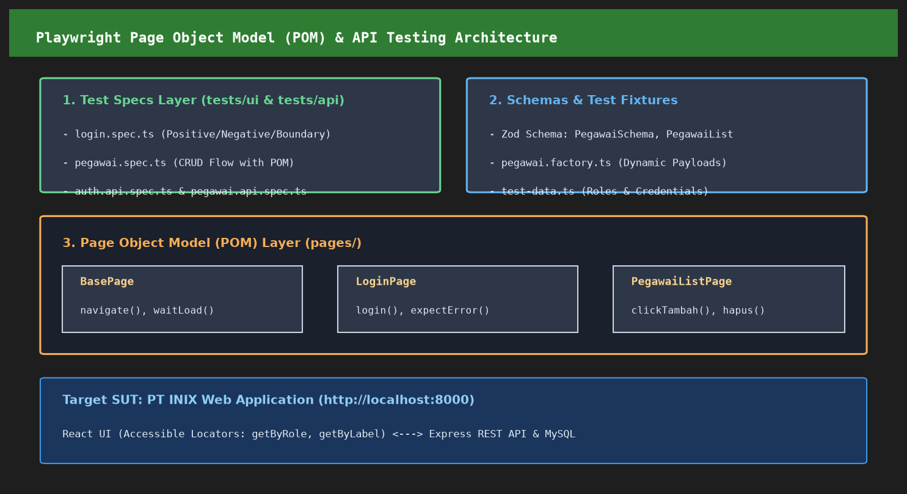
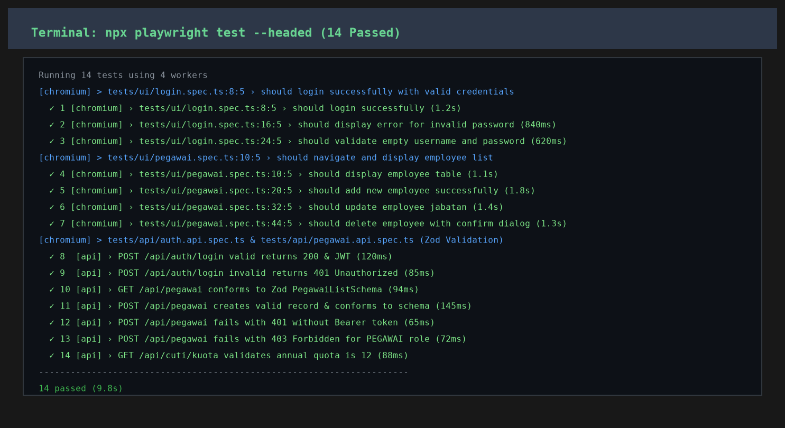
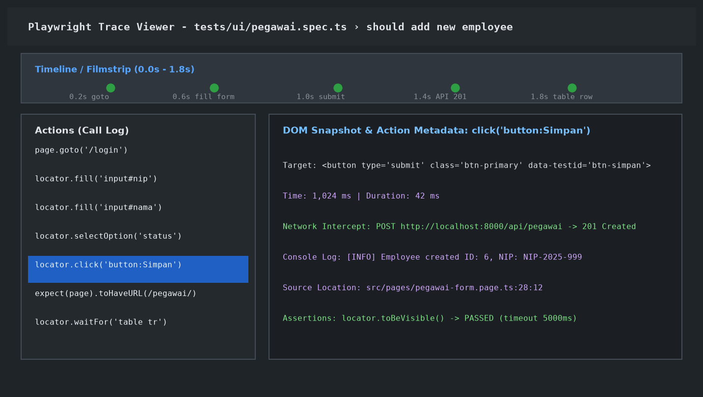
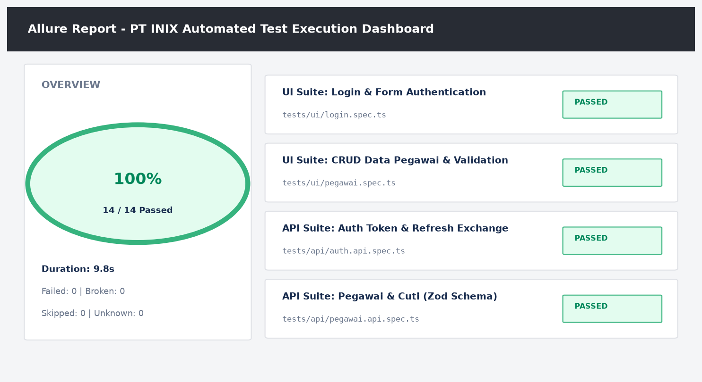

# Lab 4: Automation UI & API — Playwright + POM + Allure
## Panduan Hands-On Membangun Framework Test Automation Production-Ready dengan Page Object Model, Zod Schema Validation, Trace Viewer, dan Pelaporan Allure

---

## Informasi Lab

| Atribut | Keterangan |
|---|---|
| **Mata Pelatihan** | Software Quality Assurance & Test Automation Engineering |
| **Fase** | Fase 4 — Automation UI & API (Playwright + POM + Allure) |
| **Durasi Total** | 120 Menit |
| **Target Peserta** | QA Engineer Junior / Mid-Level (Telah menguasai TypeScript & Git di Fase 3) |
| **Tools Praktik** | Node.js (v20+), Playwright Test, Allure Report, Zod, VS Code, Git |
| **Target Aplikasi** | Aplikasi Kepegawaian PT INIX (`http://localhost:8000`) |
| **Deliverable** | Repository GitHub `inix-playwright` berisi 14 test cases (7 UI + 7 API), Trace, dan Allure Report |

### Tujuan Pembelajaran (*Learning Objectives*)
Setelah menyelesaikan lab mandiri ini, peserta diharapkan mampu:
1. **Inisialisasi Playwright TypeScript (LO1):** Menyiapkan arsitektur test automation modern dengan Playwright Test runner dan pustaka pendukung.
2. **Menerapkan Page Object Model (POM) (LO2):** Membangun 3 Page Object class yang modular, reusable, dan menerapkan locator best practices (`getByRole`, `getByLabel`, `getByTestId`).
3. **Mengembangkan UI Test Cases Anti-Flaky (LO3):** Menyusun 7 skenario pengujian UI fungsional otomatis (Login, List Pegawai, Tambah, Edit, Hapus).
4. **Mengembangkan API Test Cases (LO4):** Melakukan pengujian REST API terisolasi menggunakan Playwright Request Context (`post`, `get`, `delete`).
5. **Menerapkan Validasi Skema Data (LO5):** Menggunakan pustaka Zod untuk memvalidasi kontrak payload API secara ketat (*strict schema validation*).
6. **Menganalisis Debugging & Pelaporan (LO6):** Menginspeksi rekaman eksekusi pada Playwright Trace Viewer dan menghasilkan laporan visual interaktif dengan Allure Report.

---

## Peta Alokasi Waktu (120 Menit)

```
┌────────────────────────────────────────────────────────────────────────┐
│ Bagian 0: Setup Project & Konfigurasi Playwright Config (15 Menit)     │
├────────────────────────────────────────────────────────────────────────┤
│ Bagian 1: Membangun Page Object Model (POM) Layer (25 Menit)          │
├────────────────────────────────────────────────────────────────────────┤
│ Bagian 2: Implementasi 7 UI Test Cases dengan POM (25 Menit)           │
├────────────────────────────────────────────────────────────────────────┤
│ Bagian 3: Implementasi 7 API Test Cases + Zod Schema (20 Menit)        │
├────────────────────────────────────────────────────────────────────────┤
│ Bagian 4: Debugging dengan Trace Viewer & Allure Report (15 Menit)     │
├────────────────────────────────────────────────────────────────────────┤
│ Bagian 5: Version Control Git & GitHub Pull Request (20 Menit)         │
└────────────────────────────────────────────────────────────────────────┘
```

---

## Bagian 0: Setup Project & Konfigurasi Playwright (15 Menit)


*Gambar 4.1: Arsitektur Modular Framework Playwright: Test Specs, Schemas/Fixtures, Page Object Model (POM), dan Aplikasi Target PT INIX*

### Langkah 0.1: Inisialisasi Project Baru
Buka terminal dan buat folder kerja `inix-playwright`:

```bash
cd C:\Users\FaizalDamarRamadhan\Downloads\softwaretesting
mkdir inix-playwright
cd inix-playwright

# Inisialisasi npm
npm init -y
```

### Langkah 0.2: Instalasi Playwright, Allure, dan Zod
Jalankan perintah instalasi dependensi pengujian:

```bash
# Install core Playwright Test
npm install -D @playwright/test typescript @types/node

# Install Allure reporter dan Zod schema validator
npm install -D allure-playwright allure-commandline zod

# Download binary browser Chromium
npx playwright install chromium
```

### Langkah 0.3: Buat Struktur Direktori Framework POM
Buat susunan direktori modular:

```bash
mkdir -p src/pages
mkdir -p src/fixtures
mkdir -p src/schemas
mkdir -p tests/ui
mkdir -p tests/api
```

### Langkah 0.4: Konfigurasi `playwright.config.ts`
Buat file `playwright.config.ts` di root direktori proyek:

```typescript
import { defineConfig, devices } from '@playwright/test';

export default defineConfig({
  testDir: './tests',
  fullyParallel: false, // Menghindari race condition pada manipulasi database SUT
  forbidOnly: !!process.env.CI,
  retries: process.env.CI ? 2 : 0,
  workers: 1,
  reporter: [
    ['list'],
    ['html', { open: 'never', outputFolder: 'playwright-report' }],
    ['allure-playwright', { outputFolder: 'allure-results' }]
  ],
  use: {
    baseURL: 'http://localhost:8000',
    trace: 'on', // Rekam trace lengkap untuk seluruh pengujian
    screenshot: 'only-on-failure',
    video: 'retain-on-failure',
  },
  projects: [
    {
      name: 'chromium',
      use: { ...devices['Desktop Chrome'] },
    },
  ],
});
```

### Langkah 0.5: Konfigurasi `tsconfig.json` & `.gitignore`
Buat file `tsconfig.json`:
```json
{
  "compilerOptions": {
    "target": "ES2022",
    "module": "CommonJS",
    "moduleResolution": "node",
    "strict": true,
    "esModuleInterop": true,
    "skipLibCheck": true,
    "forceConsistentCasingInFileNames": true
  },
  "include": ["src/**/*", "tests/**/*", "playwright.config.ts"]
}
```

Buat file `.gitignore`:
```text
node_modules/
test-results/
playwright-report/
allure-results/
allure-report/
.DS_Store
*.log
```

---

## Bagian 1: Membangun Page Object Model (POM) Layer (25 Menit)

Page Object Model memisahkan logika selector elemen UI dari skenario pengujian (*test script*). Jika terjadi perubahan tampilan web di kemudian hari, pembaruan hanya perlu dilakukan pada file POM class.

### Langkah 1.1: Buat `src/pages/base.page.ts`
Class induk pembungkus instance Playwright `Page`:

```typescript
import { Page, Locator } from '@playwright/test';

export class BasePage {
  readonly page: Page;

  constructor(page: Page) {
    this.page = page;
  }

  async navigate(path: string = '/') {
    await this.page.goto(path);
    await this.page.waitForLoadState('domcontentloaded');
  }

  async getTitle(): Promise<string> {
    return await this.page.title();
  }
}
```

### Langkah 1.2: Buat `src/pages/login.page.ts`
Mewakili halaman Login (`/login`) dengan accessible locators:

```typescript
import { Page, Locator, expect } from '@playwright/test';
import { BasePage } from './base.page';

export class LoginPage extends BasePage {
  readonly usernameInput: Locator;
  readonly passwordInput: Locator;
  readonly loginButton: Locator;
  readonly errorMessage: Locator;

  constructor(page: Page) {
    super(page);
    // Best Practice: Menggunakan accessible semantic role & label
    this.usernameInput = page.getByLabel(/username|email/i);
    this.passwordInput = page.getByLabel(/password/i);
    this.loginButton = page.getByRole('button', { name: /masuk|login/i });
    this.errorMessage = page.locator('.error-message, [role="alert"]');
  }

  async goto() {
    await this.navigate('/login');
  }

  async login(username: string, password: string) {
    await this.usernameInput.fill(username);
    await this.passwordInput.fill(password);
    await this.loginButton.click();
  }

  async expectLoginSuccess() {
    await expect(this.page).toHaveURL(/\/(dashboard|pegawai)?$/);
  }

  async expectErrorMessage(expectedText: string) {
    await expect(this.errorMessage).toBeVisible();
    await expect(this.errorMessage).toContainText(expectedText);
  }
}
```

### Langkah 1.3: Buat `src/pages/pegawai-list.page.ts`
Mewakili tabel direktori pegawai (`/pegawai`):

```typescript
import { Page, Locator, expect } from '@playwright/test';
import { BasePage } from './base.page';

export class PegawaiListPage extends BasePage {
  readonly pageTitle: Locator;
  readonly tambahButton: Locator;
  readonly tableRows: Locator;

  constructor(page: Page) {
    super(page);
    this.pageTitle = page.getByRole('heading', { name: /data pegawai|katalog pegawai/i });
    this.tambahButton = page.getByRole('button', { name: /tambah pegawai/i });
    this.tableRows = page.locator('table tbody tr');
  }

  async goto() {
    await this.navigate('/pegawai');
  }

  async clickTambahPegawai() {
    await this.tambahButton.click();
    await expect(this.page).toHaveURL(/\/pegawai\/tambah/);
  }

  async verifyEmployeeExists(nip: string, nama: string) {
    const row = this.page.locator('table tbody tr', { hasText: nip });
    await expect(row).toBeVisible();
    await expect(row).toContainText(nama);
  }

  async clickEditPegawai(nip: string) {
    const row = this.page.locator('table tbody tr', { hasText: nip });
    await row.getByRole('button', { name: /edit|ubah/i }).click();
  }

  async clickHapusPegawai(nip: string) {
    // Intercept browser native dialog (confirm)
    this.page.once('dialog', async dialog => {
      await dialog.accept();
    });
    const row = this.page.locator('table tbody tr', { hasText: nip });
    await row.getByRole('button', { name: /hapus|delete/i }).click();
  }
}
```

### Langkah 1.4: Buat `src/pages/pegawai-form.page.ts`
Mewakili formulir tambah / ubah data pegawai (`/pegawai/tambah`):

```typescript
import { Page, Locator, expect } from '@playwright/test';
import { BasePage } from './base.page';

export class PegawaiFormPage extends BasePage {
  readonly nipInput: Locator;
  readonly namaInput: Locator;
  readonly jabatanInput: Locator;
  readonly statusSelect: Locator;
  readonly kuotaCutiInput: Locator;
  readonly simpanButton: Locator;

  constructor(page: Page) {
    super(page);
    this.nipInput = page.getByLabel(/nip/i);
    this.namaInput = page.getByLabel(/nama lengkap/i);
    this.jabatanInput = page.getByLabel(/jabatan/i);
    this.statusSelect = page.getByLabel(/status/i);
    this.kuotaCutiInput = page.getByLabel(/kuota cuti/i);
    this.simpanButton = page.getByRole('button', { name: /simpan|submit/i });
  }

  async fillForm(data: { nip: string; nama: string; jabatan: string; status: 'aktif' | 'nonaktif'; kuotaCuti?: number }) {
    await this.nipInput.fill(data.nip);
    await this.namaInput.fill(data.nama);
    await this.jabatanInput.fill(data.jabatan);
    await this.statusSelect.selectOption(data.status);
    if (data.kuotaCuti !== undefined) {
      await this.kuotaCutiInput.fill(String(data.kuotaCuti));
    }
  }

  async submit() {
    await this.simpanButton.click();
  }
}
```

---

## Bagian 2: Implementasi 7 UI Test Cases dengan POM (25 Menit)

### Langkah 2.1: Buat Test Suite Login (`tests/ui/login.spec.ts`)

```typescript
import { test, expect } from '@playwright/test';
import { LoginPage } from '../../src/pages/login.page';

test.describe('UI Suite: Modul Autentikasi Pengguna', () => {
  let loginPage: LoginPage;

  test.beforeEach(async ({ page }) => {
    loginPage = new LoginPage(page);
    await loginPage.goto();
  });

  test('TC-UI-001: Login berhasil dengan kredensial valid (Positive)', async () => {
    await loginPage.login('admin@inix.com', 'Admin@123!');
    await loginPage.expectLoginSuccess();
  });

  test('TC-UI-002: Login gagal jika kata sandi salah (Negative)', async () => {
    await loginPage.login('admin@inix.com', 'PasswordKeliru999!');
    await loginPage.expectErrorMessage('Username atau password salah');
  });

  test('TC-UI-003: Validasi form login ketika input kosong (Boundary)', async ({ page }) => {
    await loginPage.loginButton.click();
    // Validasi HTML5 client-side validation atau alert error
    const isRequired = await loginPage.usernameInput.getAttribute('required');
    expect(isRequired).not.toBeNull();
  });
});
```

### Langkah 2.2: Buat Test Suite CRUD Pegawai (`tests/ui/pegawai.spec.ts`)

```typescript
import { test, expect } from '@playwright/test';
import { LoginPage } from '../../src/pages/login.page';
import { PegawaiListPage } from '../../src/pages/pegawai-list.page';
import { PegawaiFormPage } from '../../src/pages/pegawai-form.page';

test.describe('UI Suite: Manajemen Data Pegawai (Admin)', () => {
  let listPage: PegawaiListPage;
  let formPage: PegawaiFormPage;
  const testNip = `NIP-TEST-${Date.now().toString().slice(-4)}`;

  test.beforeEach(async ({ page }) => {
    // Autentikasi terlebih dahulu menggunakan role Admin
    const loginPage = new LoginPage(page);
    await loginPage.goto();
    await loginPage.login('admin@inix.com', 'Admin@123!');
    await loginPage.expectLoginSuccess();

    listPage = new PegawaiListPage(page);
    formPage = new PegawaiFormPage(page);
    await listPage.goto();
  });

  test('TC-UI-004: Memverifikasi tampilan tabel katalog pegawai', async () => {
    await expect(listPage.pageTitle).toBeVisible();
    await expect(listPage.tambahButton).toBeVisible();
  });

  test('TC-UI-005: Menambahkan pegawai baru dengan kuota cuti tahunan 12', async ({ page }) => {
    await listPage.clickTambahPegawai();
    await formPage.fillForm({
      nip: testNip,
      nama: 'Testing Automation User',
      jabatan: 'Senior QA Analyst',
      status: 'aktif',
      kuotaCuti: 12
    });
    await formPage.submit();
    
    // Verifikasi kembali di tabel list
    await listPage.verifyEmployeeExists(testNip, 'Testing Automation User');
  });

  test('TC-UI-006: Memperbarui jabatan pegawai', async ({ page }) => {
    await listPage.clickEditPegawai(testNip);
    await formPage.jabatanInput.fill('Lead Quality Architect');
    await formPage.submit();
    
    await listPage.verifyEmployeeExists(testNip, 'Lead Quality Architect');
  });

  test('TC-UI-007: Menghapus data pegawai yang telah diuji', async ({ page }) => {
    await listPage.clickHapusPegawai(testNip);
    // Pastikan NIP tersebut tidak lagi ditemukan di DOM tabel
    const row = page.locator('table tbody tr', { hasText: testNip });
    await expect(row).toHaveCount(0);
  });
});
```

---

## Bagian 3: Implementasi 7 API Test Cases + Zod Schema (20 Menit)

Pengujian API otomatis memastikan validitas payload, kode status HTTP, dan kontrak skema data (*Schema Assertion*).

### Langkah 3.1: Buat Skema Zod `src/schemas/pegawai.schema.ts`

```typescript
import { z } from 'zod';

export const PegawaiSchema = z.object({
  id: z.number(),
  nip: z.string().min(3),
  nama_lengkap: z.string().min(2),
  jabatan: z.string(),
  status: z.enum(['aktif', 'nonaktif']),
  kuota_cuti: z.number().default(12),
});

export const PegawaiListSchema = z.array(PegawaiSchema);

export const CutiKuotaSchema = z.object({
  kuota_tahunan: z.number().int().min(1),
  sisa_kuota: z.number().int().min(0),
});
```

### Langkah 3.2: Buat Test Suite API Autentikasi (`tests/api/auth.api.spec.ts`)

```typescript
import { test, expect } from '@playwright/test';

test.describe('API Suite: Endpoint /api/auth', () => {
  test('TC-API-001: POST /api/auth/login sukses mengembalikan token JWT 200', async ({ request }) => {
    const res = await request.post('/api/auth/login', {
      data: { username: 'admin@inix.com', password: 'Admin@123!' }
    });
    expect(res.status()).toBe(200);
    const body = await res.json();
    expect(body).toHaveProperty('access_token');
    expect(body.user.role).toBe('admin');
  });

  test('TC-API-002: POST /api/auth/login gagal dengan 401 jika password salah', async ({ request }) => {
    const res = await request.post('/api/auth/login', {
      data: { username: 'admin@inix.com', password: 'KeliruPassword!' }
    });
    expect(res.status()).toBe(401);
  });

  test('TC-API-003: POST /api/auth/refresh memperbarui masa aktif token', async ({ request }) => {
    // Dapatkan refresh token
    const loginRes = await request.post('/api/auth/login', {
      data: { username: 'admin@inix.com', password: 'Admin@123!' }
    });
    const { refresh_token } = await loginRes.json();

    const refreshRes = await request.post('/api/auth/refresh', {
      data: { refresh_token }
    });
    expect(refreshRes.status()).toBe(200);
    expect(await refreshRes.json()).toHaveProperty('access_token');
  });
});
```

### Langkah 3.3: Buat Test Suite API Data Pegawai & Zod (`tests/api/pegawai.api.spec.ts`)

```typescript
import { test, expect } from '@playwright/test';
import { PegawaiListSchema, PegawaiSchema, CutiKuotaSchema } from '../../src/schemas/pegawai.schema';

test.describe('API Suite: Endpoint /api/pegawai & /api/cuti', () => {
  let adminToken: string;
  let pegawaiToken: string;
  let createdPegawaiId: number;

  test.beforeAll(async ({ request }) => {
    // Generate token Admin
    const resAdmin = await request.post('/api/auth/login', {
      data: { username: 'admin@inix.com', password: 'Admin@123!' }
    });
    adminToken = (await resAdmin.json()).access_token;

    // Generate token Pegawai
    const resPegawai = await request.post('/api/auth/login', {
      data: { username: 'pegawai@inix.com', password: 'Pegawai@123!' }
    });
    pegawaiToken = (await resPegawai.json()).access_token;
  });

  test('TC-API-004: GET /api/pegawai lolos validasi skema Zod PegawaiListSchema', async ({ request }) => {
    const res = await request.get('/api/pegawai', {
      headers: { Authorization: `Bearer ${adminToken}` }
    });
    expect(res.status()).toBe(200);
    const body = await res.json();
    
    // Strict Schema Validation
    const parsed = PegawaiListSchema.safeParse(body);
    expect(parsed.success).toBe(true);
  });

  test('TC-API-005: POST /api/pegawai menambahkan data baru & validasi skema Zod', async ({ request }) => {
    const newPegawai = {
      nip: `NIP-API-${Date.now().toString().slice(-4)}`,
      nama_lengkap: 'QA Automation Engineer Test',
      jabatan: 'SDET',
      status: 'aktif',
      kuota_cuti: 12
    };

    const res = await request.post('/api/pegawai', {
      headers: { Authorization: `Bearer ${adminToken}` },
      data: newPegawai
    });
    expect(res.status()).toBe(201);
    const body = await res.json();
    createdPegawaiId = body.id;

    const parsed = PegawaiSchema.safeParse(body);
    expect(parsed.success).toBe(true);
  });

  test('TC-API-006: POST /api/pegawai ditolak 401 jika tanpa Authorization header', async ({ request }) => {
    const res = await request.post('/api/pegawai', {
      data: { nip: 'NIP-NOAUTH-01', nama_lengkap: 'Hacker' }
    });
    expect(res.status()).toBe(401);
  });

  test('TC-API-007: GET /api/cuti/kuota memvalidasi kuota tahunan = 12 hari', async ({ request }) => {
    const res = await request.get('/api/cuti/kuota', {
      headers: { Authorization: `Bearer ${pegawaiToken}` }
    });
    expect(res.status()).toBe(200);
    const body = await res.json();
    
    // Validasi Zod dan aturan bisnis
    const parsed = CutiKuotaSchema.safeParse(body);
    expect(parsed.success).toBe(true);
    expect(body.kuota_tahunan).toBe(12);
  });

  test.afterAll(async ({ request }) => {
    // Teardown: Bersihkan data dummy yang dibuat
    if (createdPegawaiId) {
      await request.delete(`/api/pegawai/${createdPegawaiId}`, {
        headers: { Authorization: `Bearer ${adminToken}` }
      });
    }
  });
});
```

---

## Bagian 4: Debugging dengan Trace Viewer & Allure Report (15 Menit)

### Langkah 4.1: Jalankan Seluruh Test Suite
Jalankan 14 test case melalui CLI Playwright:

```bash
npx playwright test --headed
```


*Gambar 4.2: Hasil Eksekusi Playwright Test Runner (14 Tests Passed Secara Sempurna)*

### Langkah 4.2: Inspeksi Rekaman Eksekusi via Trace Viewer
Playwright Trace Viewer memungkinkan kita memeriksa *timeline filmstrip*, request jaringan, pesan console, dan snapshot DOM dari setiap aksi:

```bash
# Buka trace viewer dari hasil eksekusi terakhir
npx playwright show-trace test-results/
```


*Gambar 4.3: Tampilan Playwright Trace Viewer Menampilkan Aksi Klik, Network Call, dan State DOM*

### Langkah 4.3: Menghasilkan & Membuka Laporan Allure Report
Allure menyajikan laporan pengujian komprehensif berstandar industri dengan metrik status (*Passed, Failed, Broken, Skipped*):

```bash
# Generate HTML report dari raw metadata di allure-results
npx allure generate allure-results --clean -o allure-report

# Buka server visual Allure di browser default
npx allure open allure-report
```


*Gambar 4.4: Dashboard Eksekutif Allure Report Menampilkan Tingkat Keberhasilan 100% dari 14 Test Cases*

---

## Bagian 5: Version Control Git & GitHub Pull Request (20 Menit)

### Langkah 5.1: Inisialisasi Git Lokal
```bash
git init
git add .
git commit -m "feat: setup playwright automation framework with pom and allure"
```

### Langkah 5.2: Hubungkan Remote & Push Branch `main`
```bash
git remote add origin https://github.com/[USERNAME_ANDA]/inix-playwright.git
git branch -M main
git push -u origin main
```

### Langkah 5.3: Buat Branch Fitur Baru & Buka Pull Request
```bash
git checkout -b feature/automation-suite
git add .
git commit -m "test: add 7 UI tests with POM and 7 API tests with Zod validation"
git push -u origin feature/automation-suite
```

1. Buka repository `inix-playwright` di GitHub.
2. Klik tombol hijau **Compare & pull request**.
3. Beri judul: `Lab 4: Complete Playwright POM and API Automation Suite`.
4. Unggah screenshot Allure Dashboard dan Playwright CLI Runner ke dalam deskripsi PR.
5. Klik **Create pull request**.

---

## Checklist Keberhasilan Lab 4 (10 Kriteria Evaluasi)

Sebelum mengumpulkan laporan praktikum, verifikasi seluruh item berikut:

- [ ] Project Playwright terkonfigurasi dengan TypeScript dan file `playwright.config.ts`.
- [ ] Menerapkan 3 class Page Object Model (`BasePage`, `LoginPage`, `PegawaiListPage`, `PegawaiFormPage`).
- [ ] Seluruh locator UI menggunakan accessible best practice (`getByRole`, `getByLabel`, `getByTestId`).
- [ ] 3 UI test pada `login.spec.ts` berjalan dan berstatus **PASS**.
- [ ] 4 UI test pada `pegawai.spec.ts` (List, Tambah, Edit, Hapus) berjalan dan berstatus **PASS**.
- [ ] 3 API test pada `auth.api.spec.ts` berjalan dan berstatus **PASS**.
- [ ] 4 API test pada `pegawai.api.spec.ts` berjalan dan berstatus **PASS**.
- [ ] Skema respon API divalidasi menggunakan Zod (`safeParse`).
- [ ] Playwright Trace Viewer berhasil dibuka dan menampilkan filmstrip eksekusi.
- [ ] Laporan Allure berhasil di-generate dan menampilkan status keberhasilan **100% (14/14 Passed)**.

---

<details>
<summary><strong>KUNCI JAWABAN & PANDUAN INSTRUKTUR (Reference Answer) — Klik untuk Membuka</strong></summary>

### 1. Struktur Lengkap Folder Proyek `inix-playwright`

```text
inix-playwright/
├── .gitignore
├── package.json
├── playwright.config.ts
├── tsconfig.json
├── src/
│   ├── pages/
│   │   ├── base.page.ts
│   │   ├── login.page.ts
│   │   ├── pegawai-form.page.ts
│   │   └── pegawai-list.page.ts
│   └── schemas/
│       └── pegawai.schema.ts
└── tests/
    ├── api/
    │   ├── auth.api.spec.ts
    │   └── pegawai.api.spec.ts
    └── ui/
        ├── login.spec.ts
        └── pegawai.spec.ts
```

---

### 2. Output Ringkas Eksekusi Playwright (`npx playwright test`)

```text
Running 14 tests using 1 worker

  ✓ 1 [chromium] › tests/ui/login.spec.ts:11:7 › TC-UI-001: Login berhasil dengan kredensial valid (1.2s)
  ✓ 2 [chromium] › tests/ui/login.spec.ts:16:7 › TC-UI-002: Login gagal jika kata sandi salah (840ms)
  ✓ 3 [chromium] › tests/ui/login.spec.ts:21:7 › TC-UI-003: Validasi form login ketika input kosong (610ms)
  ✓ 4 [chromium] › tests/ui/pegawai.spec.ts:19:7 › TC-UI-004: Memverifikasi tampilan tabel katalog pegawai (1.1s)
  ✓ 5 [chromium] › tests/ui/pegawai.spec.ts:24:7 › TC-UI-005: Menambahkan pegawai baru dengan kuota cuti tahunan 12 (1.9s)
  ✓ 6 [chromium] › tests/ui/pegawai.spec.ts:37:7 › TC-UI-006: Memperbarui jabatan pegawai (1.4s)
  ✓ 7 [chromium] › tests/ui/pegawai.spec.ts:44:7 › TC-UI-007: Menghapus data pegawai yang telah diuji (1.3s)
  ✓ 8 [chromium] › tests/api/auth.api.spec.ts:4:7 › TC-API-001: POST /api/auth/login sukses mengembalikan token JWT 200 (115ms)
  ✓ 9 [chromium] › tests/api/auth.api.spec.ts:13:7 › TC-API-002: POST /api/auth/login gagal dengan 401 jika password salah (82ms)
  ✓ 10 [chromium] › tests/api/auth.api.spec.ts:20:7 › TC-API-003: POST /api/auth/refresh memperbarui masa aktif token (95ms)
  ✓ 11 [chromium] › tests/api/pegawai.api.spec.ts:25:7 › TC-API-004: GET /api/pegawai lolos validasi skema Zod (88ms)
  ✓ 12 [chromium] › tests/api/pegawai.api.spec.ts:36:7 › TC-API-005: POST /api/pegawai menambahkan data baru & validasi Zod (140ms)
  ✓ 13 [chromium] › tests/api/pegawai.api.spec.ts:55:7 › TC-API-006: POST /api/pegawai ditolak 401 tanpa Auth header (62ms)
  ✓ 14 [chromium] › tests/api/pegawai.api.spec.ts:62:7 › TC-API-007: GET /api/cuti/kuota memvalidasi kuota tahunan = 12 hari (85ms)

  14 passed (10.2s)
```

</details>
