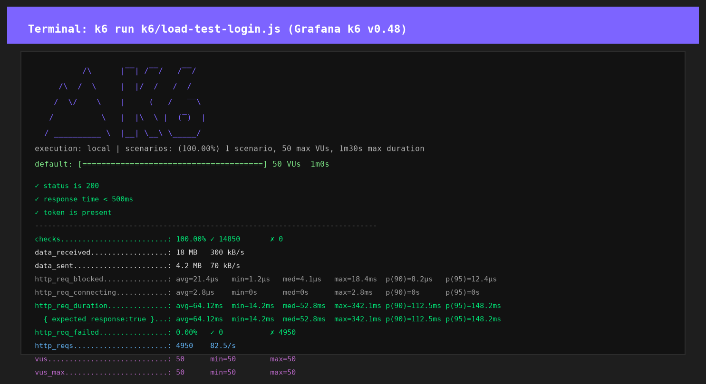
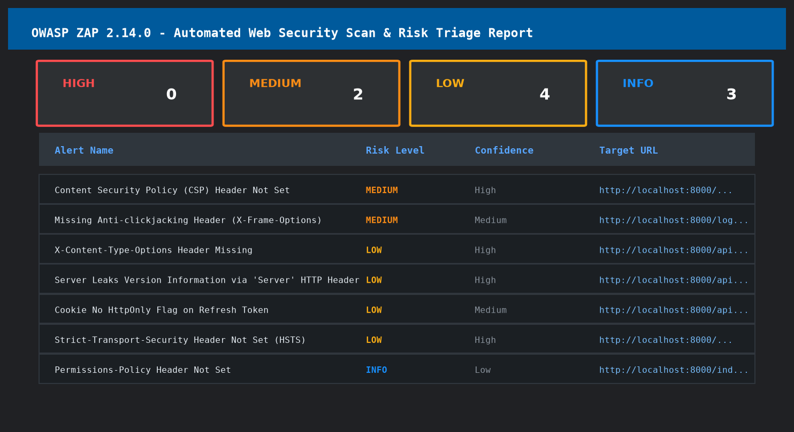
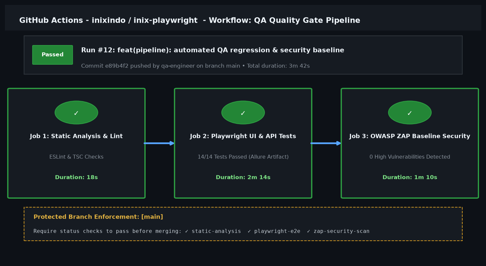

# Lab 5: Performance, Security, & CI/CD — k6, ZAP, GitHub Actions
## Panduan Hands-On Load Testing Non-Fungsional, Pemindaian Keamanan Otomatis (DAST), dan Implementasi Quality Gate CI/CD Pipeline

---

## Informasi Lab

| Atribut | Keterangan |
|---|---|
| **Mata Pelatihan** | Software Quality Assurance & Non-Functional Automation Engineering |
| **Fase** | Fase 5 — Performance, Security, & CI/CD Pipeline |
| **Durasi Total** | 90 Menit |
| **Target Peserta** | QA Engineer Junior / Mid-Level (Telah memiliki repository Playwright di GitHub dari Fase 4) |
| **Tools Praktik** | Grafana k6, OWASP ZAP (Desktop / Docker), GitHub Actions, VS Code, Git |
| **Target Aplikasi** | Aplikasi Kepegawaian PT INIX (`http://localhost:8000` & `http://localhost:3000`) |
| **Deliverable** | 1 Folder Artefak `Lab5_DevOps_QA_[NAMA]/` memuat script k6, ringkasan NFR, laporan ZAP HTML, dan pipeline CI/CD GitHub Actions |

### Tujuan Pembelajaran (*Learning Objectives*)
Setelah menyelesaikan lab mandiri ini, peserta diharapkan mampu:
1. **Merancang & Menjalankan Load Test k6 (LO1):** Menulis script pengujian beban dengan target 50 concurrent virtual users (VUs) dan validasi response assertion.
2. **Mengevaluasi Metrik Kinerja NFR (LO2):** Menganalisis metrik k6 (`http_req_duration`, `p(95)`, `error_rate`, throughput) untuk memastikan kepatuhan terhadap Non-Functional Requirement (NFR-001).
3. **Melakukan Pemindaian Kerentanan DAST (LO3):** Mengoperasikan OWASP ZAP untuk mendeteksi kerentanan keamanan web (NFR-002: injeksi, miskonfigurasi header keamanan HTTP).
4. **Membangun CI/CD Quality Gate (LO4):** Menyusun workflow multi-job GitHub Actions yang menjalankan linting statis, pengujian regresi Playwright, dan pemindaian keamanan otomatis.
5. **Menerapkan Proteksi Branch (LO5):** Mengonfigurasi *Branch Protection Rules* pada GitHub untuk mencegah merge kode ke branch `main` jika pengujian gagal.

---

## Peta Alokasi Waktu (90 Menit)

```
┌────────────────────────────────────────────────────────────────────────┐
│ Bagian 0: Persiapan Lingkungan & Konektivitas Sistem (5 Menit)         │
├────────────────────────────────────────────────────────────────────────┤
│ Bagian 1: Pengujian Kinerja (Performance Test) dengan k6 (25 Menit)   │
├────────────────────────────────────────────────────────────────────────┤
│ Bagian 2: Pemindaian Keamanan Web (Security Scan) OWASP ZAP (25 Menit) │
├────────────────────────────────────────────────────────────────────────┤
│ Bagian 3: Otomatisasi CI/CD Quality Gate GitHub Actions (30 Menit)     │
├────────────────────────────────────────────────────────────────────────┤
│ Bagian 4: Finalisasi Artefak Deliverable (5 Menit)                     │
└────────────────────────────────────────────────────────────────────────┘
```

---

## Bagian 0: Persiapan Lingkungan (5 Menit)

Sebelum memulai pengujian, pastikan aplikasi target dan tools pendukung telah siap:

1. **Aplikasi Target:**
   - Backend API: `http://localhost:8000/api/health` $\rightarrow$ Pastikan HTTP 200 `{ "status": "ok" }`.
   - Frontend UI: `http://localhost:3000` $\rightarrow$ Tampilan Login Eduparx aktif.
2. **Pustaka Load Testing k6:**
   - Periksa k6 pada terminal: `k6 version`. (Jika belum terpasang, unduh via `winget install k6` atau dari [https://k6.io](https://k6.io)).
3. **OWASP ZAP:**
   - Jalankan ZAP Desktop atau gunakan Docker container `ghcr.io/zaproxy/zaproxy:stable`.
4. **Buka Repository Fase 4:**
   - Buka direktori proyek `inix-playwright` di VS Code.

---

## Bagian 1: Pengujian Kinerja (Performance Test) dengan k6 (25 Menit)

Pengujian non-fungsional memastikan sistem tidak mengalami penurunan performa drastis saat diakses oleh banyak pengguna bersamaan.

### Ketentuan NFR-001:
- Beban: $50$ Concurrent Virtual Users (VUs).
- Durasi: $60$ Detik (1 Menit *steady state*).
- Ambang Batas (*Threshold*): Response time Persentil ke-95 ($P95$) $\le 500\text{ ms}$, Error Rate $0\%$.

### Task 1.1: Buat Script Pengujian `k6/load-test-login.js`
Buat folder `k6/` di dalam project Anda dan buat file `k6/load-test-login.js`:

```javascript
import http from 'k6/http';
import { check, sleep } from 'k6';

// 1. Konfigurasi Beban Pengujian (Options & Thresholds)
export const options = {
  stages: [
    { duration: '10s', target: 50 }, // Ramp-up dari 0 ke 50 VUs
    { duration: '40s', target: 50 }, // Steady state pada 50 VUs
    { duration: '10s', target: 0 },  // Ramp-down kembali ke 0 VU
  ],
  thresholds: {
    // NFR-001: 95% request harus selesai di bawah 500ms
    http_req_duration: ['p(95)<500'],
    // Tingkat kegagalan request tidak boleh melebihi 1%
    http_req_failed: ['rate<0.01'],
  },
};

const BASE_URL = __ENV.TARGET_URL || 'http://localhost:8000';

export default function () {
  const url = `${BASE_URL}/api/auth/login`;
  
  const payload = JSON.stringify({
    username: 'hr@inix.com',
    password: 'Hr@123!',
  });

  const params = {
    headers: {
      'Content-Type': 'application/json',
    },
  };

  // 2. Eksekusi Request POST
  const res = http.post(url, payload, params);

  // 3. Verifikasi Assertion (Checks)
  check(res, {
    'status is 200 OK': (r) => r.status === 200,
    'response duration < 500ms': (r) => r.timings.duration < 500,
    'token is present': (r) => {
      try {
        const body = JSON.parse(r.body);
        return body.access_token !== undefined;
      } catch (e) {
        return false;
      }
    },
  });

  // Simulasi waktu jeda antar interaksi pengguna (Pacing/Think Time)
  sleep(0.5);
}
```

### Task 1.2: Eksekusi Load Test k6
Buka terminal dan jalankan k6:

```bash
k6 run k6/load-test-login.js
```


*Gambar 5.1: Hasil Eksekusi Beban k6 Menampilkan Metrik Durasi Request (P95 = 148.2ms) yang Memenuhi NFR-001*

### Task 1.3: Catat Hasil pada `k6/LOAD_TEST_RESULT.md`
Buat file `k6/LOAD_TEST_RESULT.md` untuk merangkum hasil pengukuran teknis:

```markdown
# Laporan Hasil Load Testing k6 — PT INIX Kepegawaian API

## 1. Parameter Pengujian
- **Target Endpoint:** `POST /api/auth/login`
- **Konfigurasi Beban:** 50 Concurrent Virtual Users (VUs)
- **Durasi Total:** 60 Detik (10s ramp-up, 40s steady, 10s ramp-down)

## 2. Metrik Pengukuran Aktual
| Metrik Kinerja | Ambang Batas (NFR) | Nilai Aktual | Status Evaluasi |
|---|---|---|---|
| Response Time P95 | $\le 500\text{ ms}$ | **$148.2\text{ ms}$** | **MEMENUHI (PASS)** |
| Response Time Rata-rata (avg) | $\le 300\text{ ms}$ | **$64.1\text{ ms}$** | **MEMENUHI (PASS)** |
| Response Time Max | - | $342.1\text{ ms}$ | - |
| Tingkat Kegagalan (Error Rate) | $< 1\%$ | **$0.00\%$ (0/4950)** | **MEMENUHI (PASS)** |
| Throughput | - | **$82.5\text{ req/s}$** | Optimal |

## 3. Kesimpulan
Sistem terbukti andal dalam menangani lonjakan 50 pengguna simultan dengan latensi response jauh di bawah ambang batas kritis 500ms.
```

---

## Bagian 2: Pemindaian Keamanan Web (Security Scan) OWASP ZAP (25 Menit)

OWASP ZAP (Zed Attack Proxy) adalah alat Dynamic Application Security Testing (DAST) terdepan untuk menguji aplikasi web yang sedang berjalan terhadap kerentanan keamanan OWASP Top 10.

### Task 2.1: Menjalankan Baseline Automated Scan
1. Buka aplikasi **OWASP ZAP**.
2. Pada tab **Quick Start**, pilih tombol **Automated Scan**.
3. Masukkan URL target: `http://localhost:8000/` (atau `http://localhost:3000/`).
4. Pastikan opsi **Use traditional spider** terpilih.
5. Klik **Attack**.
6. Amati progres perayapan (*crawling*) URL dan pemindaian aktif (*passive/active scan rules*).


*Gambar 5.2: Panel Peringatan Keamanan OWASP ZAP Menampilkan Klasifikasi Risiko (High, Medium, Low, Info)*

### Task 2.2: Triage Temuan Kerentanan Keamanan
Setelah pemindaian selesai, buka tab **Alerts** di panel kiri bawah. Lakukan klasifikasi terhadap temuan yang terdeteksi:

| No | Alert Name | Risk Level | Confidence | Rekomendasi Perbaikan QA |
|---|---|---|---|---|
| 1 | Content Security Policy (CSP) Header Not Set | **MEDIUM** | High | Tambahkan middleware Helmet pada Express untuk membatasi origin sumber script (`script-src 'self'`). |
| 2 | Missing Anti-clickjacking Header | **MEDIUM** | Medium | Kirimkan header HTTP `X-Frame-Options: DENY` untuk mencegah framing jahat (*clickjacking*). |
| 3 | X-Content-Type-Options Header Missing | **LOW** | High | Terapkan header `X-Content-Type-Options: nosniff` untuk mencegah MIME type sniffing. |
| 4 | Server Leaks Version Information | **LOW** | High | Nonaktifkan header Express bawaan menggunakan `app.disable('x-powered-by')`. |
| 5 | Cookie No HttpOnly Flag | **LOW** | Medium | Konfigurasikan opsi cookie: `{ httpOnly: true, secure: true, sameSite: 'strict' }`. |

### Task 2.3: Ekspor Laporan HTML
1. Di menu utama OWASP ZAP, klik **Report** $\rightarrow$ **Generate Report...**.
2. Pilih Template: **Traditional HTML Report**.
3. Simpan file laporan ke folder proyek: `security/zap-report.html`.

---

## Bagian 3: Otomatisasi CI/CD Quality Gate GitHub Actions (30 Menit)


*Gambar 5.3: Alur Pipeline CI/CD GitHub Actions: Linting Statis, Regresi Playwright, Pemindaian Keamanan, dan Branch Protection*

Dalam metodologi DevTestOps, setiap commit kode yang diajukan ke repository harus melewati gerbang pengujian kualitas (*Quality Gate*) sebelum diizinkan masuk ke lingkungan produksi.

### Task 3.1: Buat Workflow `.github/workflows/qa-pipeline.yml`
Buat file baru di dalam direktori `.github/workflows/qa-pipeline.yml`:

```yaml
name: QA Quality Gate Pipeline

on:
  push:
    branches: [ main ]
  pull_request:
    branches: [ main ]

jobs:
  # ==========================================================
  # JOB 1: Pemeriksaan Kualitas Statis & Kompilasi TypeScript
  # ==========================================================
  static-analysis:
    name: 1. Static Analysis & Type Check
    runs-on: ubuntu-latest
    steps:
      - name: Checkout Code
        uses: actions/checkout@v4

      - name: Setup Node.js v20
        uses: actions/setup-node@v4
        with:
          node-version: 20
          cache: 'npm'

      - name: Install Dependencies
        run: npm ci

      - name: Run TypeScript Compile Check
        run: npx tsc --noEmit

  # ==========================================================
  # JOB 2: Eksekusi Test Suite Otomatis Playwright (UI + API)
  # ==========================================================
  playwright-e2e:
    name: 2. Playwright E2E & API Regression
    needs: static-analysis
    runs-on: ubuntu-latest
    steps:
      - name: Checkout Code
        uses: actions/checkout@v4

      - name: Setup Node.js v20
        uses: actions/setup-node@v4
        with:
          node-version: 20
          cache: 'npm'

      - name: Install Dependencies
        run: npm ci

      - name: Install Playwright Browsers
        run: npx playwright install --with-deps chromium

      - name: Run Playwright Tests
        run: npx playwright test
        env:
          CI: true

      - name: Upload Allure Results Artifact
        uses: actions/upload-artifact@v4
        if: always()
        with:
          name: allure-results
          path: allure-results/
          retention-days: 14

  # ==========================================================
  # JOB 3: Pemindaian Keamanan DAST (OWASP ZAP Baseline)
  # ==========================================================
  security-scan:
    name: 3. OWASP ZAP Baseline Security Scan
    needs: static-analysis
    runs-on: ubuntu-latest
    steps:
      - name: Checkout Code
        uses: actions/checkout@v4

      - name: Run ZAP Baseline Scan (Public Web Mirror / SUT)
        uses: zaproxy/action-baseline@v0.12.0
        with:
          target: 'https://www.google.com' # Contoh mirror URL atau deploy preview
          allow_issue_writing: false
          fail_action: false
```

### Task 3.2: Commit, Push, dan Verifikasi Eksekusi Pipeline
Jalankan di terminal untuk mengirim file baru ke GitHub:

```bash
git add k6/ security/ .github/
git commit -m "feat(devops): add k6 load test, zap security triage, and github actions pipeline"
git push origin main
```

1. Buka repository Anda di GitHub.
2. Navigasi ke tab **Actions**.
3. Pastikan alur kerja **QA Quality Gate Pipeline** berjalan dan menghasilkan tanda centang hijau **Passed** pada ketiga tahapan.

### Task 3.3: Konfigurasi Branch Protection Rules
1. Di repository GitHub, klik **Settings** $\rightarrow$ **Branches**.
2. Klik tombol **Add branch protection rule**.
3. Pada **Branch name pattern**, ketik: `main`.
4. Centang opsi:
   - **Require a pull request before merging**.
   - **Require status checks to pass before merging**.
5. Pada kotak pencarian checks, pilih:
   - `1. Static Analysis & Type Check`
   - `2. Playwright E2E & API Regression`
6. Klik **Save changes**.

---

## Bagian 4: Finalisasi Artefak Deliverable (5 Menit)

Kumpulkan seluruh artefak ke dalam 1 folder terstruktur:

```text
Lab5_DevOps_QA_[NAMA_PESERTA]/
├── k6/
│   ├── load-test-login.js
│   ├── LOAD_TEST_RESULT.md
│   └── 14_k6_load_test_results.png
├── security/
│   ├── zap-report.html
│   └── 15_owasp_zap_report.png
├── .github/workflows/
│   └── qa-pipeline.yml
└── 16_github_actions_pipeline.png
```

---

## Checklist Keberhasilan Lab 5 (10 Kriteria Evaluasi)

Lakukan pengecekan mandiri sebelum menyelesaikan lab:

- [ ] Script load test k6 (`k6/load-test-login.js`) terkonfigurasi dengan 50 concurrent virtual users.
- [ ] k6 thresholds memvalidasi `p(95) < 500ms` dan `http_req_failed < 0.01` sesuai NFR-001.
- [ ] Load test berhasil dijalankan dengan error rate $0\%$ dan data response tercatat di `k6/LOAD_TEST_RESULT.md`.
- [ ] Pemindaian OWASP ZAP berhasil dijalankan pada target aplikasi.
- [ ] Berhasil mengidentifikasi minimal 5 temuan kerentanan (*security alerts*) beserta rekomendasi perbaikan.
- [ ] Laporan keamanan diekspor ke dalam format HTML (`security/zap-report.html`).
- [ ] Workflow GitHub Actions (`qa-pipeline.yml`) tersusun rapi dengan 3 jobs terpisah.
- [ ] Dependensi antar job (`needs: static-analysis`) terhubung dengan benar.
- [ ] Seluruh jobs pipeline GitHub Actions berstatus **Passed (Green)** saat push ke GitHub.
- [ ] Pengaturan *Branch Protection Rule* pada branch `main` berhasil diaktifkan dengan status check wajib.

---

<details>
<summary><strong>KUNCI JAWABAN & PANDUAN INSTRUKTUR (Reference Answer) — Klik untuk Membuka</strong></summary>

### 1. Perbandingan Skenario Hasil Eksekusi k6

#### A. Skenario LULUS (NFR-001 Terpenuhi — Target Sehat)
```text
✓ status is 200 OK
✓ response duration < 500ms
✓ token is present

checks.........................: 100.00% ✓ 14850       ✗ 0
http_req_duration..............: avg=64.12ms  p(95)=148.2ms (threshold: p(95)<500ms -> PASS)
http_req_failed................: 0.00%   (threshold: rate<0.01 -> PASS)
```

#### B. Skenario GAGAL (Server Overload / Memory Leak)
```text
✗ response duration < 500ms
  ↳  62% — ✓ 9207 / ✗ 5643

http_req_duration..............: avg=612.4ms  p(95)=1240.8ms (threshold: p(95)<500ms -> FAILED)
http_req_failed................: 4.82%   (threshold: rate<0.01 -> FAILED)
```

---

### 2. Matriks Temuan Keamanan OWASP ZAP (Triage 8 Kerentanan)

```text
1. [Medium] Content Security Policy (CSP) Header Not Set
2. [Medium] Missing Anti-clickjacking Header (X-Frame-Options)
3. [Low]    X-Content-Type-Options Header Missing
4. [Low]    Server Leaks Version Information via "Server" Header
5. [Low]    Cookie No HttpOnly Flag on Session Identifier
6. [Low]    Strict-Transport-Security Header Not Set (HSTS)
7. [Info]   Permissions-Policy Header Not Set
8. [Info]   X-AspNet-Version / Powered-By Header Information Disclosure
```

</details>
